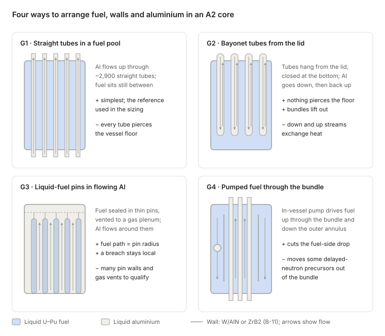
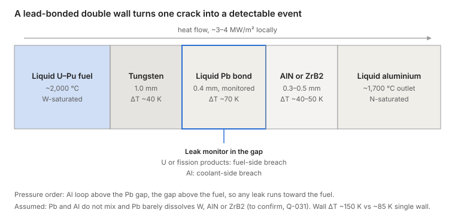

# A2: Liquid U–Pu pool cooled by aluminium

Physically plausible but unproven. On paper a 1,000 MWth core works at an average wall heat flux of 2–3 MW/m². Aluminium leaves at ~1,750–1,880 °C with peak fuel at 2,100 °C, pumping costs well under 1 MW, the coolant never boils, and decay heat can leave by radiation. Feasibility hangs on one unknown: whether any tube wall survives liquid uranium on one face, liquid aluminium on the other, ~2,000 °C and ~10–15 dpa per year. The doubling time is not shortened: it stays at ~20–35 years, like an oxide SFR.

All figures come from a one-dimensional sizing model with approximate properties (assumptions at the end). Monte Carlo and measured data must replace them.

## Reference configuration

| Item | Value (approx.) |
| --- | --- |
| Thermal power | 1,000 MWth |
| Core | Tube bundle immersed in a stationary fuel pool, ~1.2 m diameter × ~2.8 m tall (~3.3 m³) |
| Tubes | ~2,900 tubes, 10 mm bore, 1.5 mm wall (1.2 mm W + 0.3 mm AlN on the Al side), 20 mm pitch |
| Fuel | Liquid U–Pu metal, ~35 t, 67% of core volume; no forced flow |
| Aluminium | Inlet ~1,200 °C, outlet ~1,750 °C, ~1.5 t/s at 3 m/s in the tubes |
| Pressures | Fuel cover gas near-atmospheric; Al loop a few bar higher, so any leak runs from Al into fuel |
| Pumping | ~50 kPa across the core, ~35 kW; whole loop well under 1 MW |
| Power density and flux | ~300 MW/m³ of core (~460 MW/m³ of fuel); total flux ~1.5 × 10¹⁵ n/cm²·s |

## Heat-flux trade-off

Raising the average wall heat flux shrinks the core and the plutonium inventory, but raises wall stress and fuel temperature, which lowers the aluminium outlet for a fixed 2,100 °C fuel limit.

| Average heat flux (MW/m²) | Core volume (m³) | Fuel (t) | Pu at 12% (t) | Max Al outlet, ZrB2 / W–AlN (°C) | Peak wall thermal stress, ZrB2 / W (MPa) | Doubling time at BR 1.5 / 1.3 (years) |
| --- | --- | --- | --- | --- | --- | --- |
| 1 | 9.8 | 105 | 12.6 | 1,970 / 1,990 | 73 / 20 | 66 / 110 |
| 2 | 4.9 | 52 | 6.3 | 1,840 / 1,880 | 145 / 39 | 33 / 55 |
| 3 | 3.3 | 35 | 4.2 | 1,710 / 1,770 | 218 / 59 | 22 / 37 |
| 5 | 2.0 | 21 | 2.5 | 1,440 / 1,540 | 364 / 98 | 13 / 22 |

- **W/AlN beats monolithic ZrB2.** A brittle diboride is limited to ~1–1.5 MW/m² at ~100 MPa allowable; tungsten reaches 3 MW/m² with stresses it relaxes by creep. A 1 mm ZrB2 wall would halve its stress.
- **The fuel side dominates the temperature drop.** At the reference point the hot end loses ~40 K in the aluminium film, ~85 K across the wall and ~205 K inside the fuel, by conduction across 7 mm gaps (k ~40 W/m·K). A natural-convection check (Ra ~10⁴, aspect ratio ~400, Pr ~0.02) gives Nu ≈ 1: buoyant flow exists but adds almost nothing to sideways heat transfer. Approximate properties; a 3D CFD cell model would settle it ([Q-034](../open-questions.md)).
- **Doubling time stays SFR-like.** The 12% Pu fraction is an assumption; a core this large probably needs ~8%, which cuts inventory and doubling time by about a third.

## Core geometry options

| Option | Description | For | Against |
| --- | --- | --- | --- |
| G1 Straight tubes in a fuel pool | Al flows up ~2,900 straight tubes; fuel still between | Simplest; used in the sizing | Every tube pierces the vessel floor |
| G2 Bayonet tubes from the lid | Closed-bottom tubes hang from the lid; Al down the centre, up the annulus | Nothing below the fuel line; bundles lift out | Down and up streams exchange heat |
| G3 Liquid-fuel pins in flowing Al | Fuel sealed in thin vented pins; Al flows around | Fuel conduction path = pin radius; breach stays local | Many pin walls facing both metals; gas vents to qualify |
| G4 Pumped fuel through the bundle | In-vessel pump drives fuel up the bundle, down the annulus | Cuts the ~200 K fuel-side drop | Carries some delayed-neutron precursors out of the bundle |

All share a fertile blanket around the core and a guard-heated drain tank.

## Feasibility scorecard

| Aspect | Verdict | Basis |
| --- | --- | --- |
| Aluminium-side thermal hydraulics | Feasible | Heat transfer coefficient ~90 kW/m²·K; pumping ~35 kW; ~600 K margin to boiling (JANAF gives 2,518 °C, handbooks 2,470 °C) |
| Fuel-side heat transfer | Feasible | Conduction drop ~200 K at 3 MW/m²; tighter pitch helps but lowers fuel fraction |
| Criticality and breeding ratio | Open | Far above critical size; Pu fraction, BR and Al dilution need Monte Carlo ([Q-033](../open-questions.md)) |
| Reactivity feedback | Open | Liquid-fuel expansion gives strong negative feedback; no coolant boiling; Al ingress dilutes the fuel (expected negative, to compute) |
| Tube wall survival | **Critical risk** | No data at ~2,000 °C in two liquid metals at 10–15 dpa/year ([Q-030](../open-questions.md)); mitigations below |
| Breach consequences | Open | U + 2Al → UAl2 releases ~1.7 MJ per kg Al *(approx.)*, no gas; Al at higher pressure enters the fuel; detect by fission products in the Al loop ([Q-035](../open-questions.md)) |
| Fuel chemistry | Open | Volatile fission products leave the fuel; Pu vapour ~1 mbar; lanthanides build up, so online processing is needed |
| Decay heat removal | Feasible | Radiation at 2,000 °C: ~0.45 MW/m² from tungsten (emissivity ~0.3); ~20 m² vessel sheds ~9 MW |
| Freeze, drain, restart | Open | Fuel solidus ~1,100 °C vs Al inlet ~1,200 °C leaves ~100 K; drain tank and guard heating required |
| Doubling time | Feasible | ~20–35 years: no gain over an oxide SFR |
| Power conversion | Open | Al-to-helium heat exchanger needs AlN or boride walls; turbine inlet limited to ~1,500 °C by blades |

## Mitigating the tube-wall risk

No single fix; five layers of defence together could move the wall from critical to open, only confirmed by capsule and irradiation tests.

| Failure mechanism | Mitigations | Verified by |
| --- | --- | --- |
| Dissolution by liquid U–Pu | Pre-saturate the fuel with W; nearly isothermal stationary pool limits mass transfer; frozen fuel skull at the cold end; optional ~50 µm Y2O3 coat (costs ~60 K); tantalum fallback | Isothermal and thermal-gradient capsules at 2,000 °C |
| Dissolution by liquid Al | Nitrogen-saturated Al keeps AlN stable and may re-nitride small cracks; Zr-saturated Al for ZrB2; no W ever exposed to Al | Flowing-Al loop tests at 1,800 °C on coated tubes |
| Thermal stress and shock | Pressure-balanced walls (~1 MPa membrane stress); free axial expansion (G2); heat flux ≤ 3 MW/m² or G3/G4; plant kept above ~1,100 °C with slow ramps | Electron-beam or induction tests at 3–4 MW/m² with cycling |
| Expansion mismatch | W and AlN match (~5 × 10⁻⁶/K); W/ZrB2 needs a graded interlayer; a liquid bond decouples layers | Thermal cycling of duplex tubes |
| Irradiation embrittlement, swelling, transmutation | Run ≥ 1,600 °C so defects anneal; K-doped or La2O3-dispersed W; isotope-tailored W-184/186; ≥ 99.9% B-11 in ZrB2; N-15 in AlN | Ion irradiation at temperature, then fast-reactor capsules |
| Creep | Low pressure difference; tubes hung in light tension | Creep tests at 1,900–2,100 °C |
| Undetected breach | Lead-bonded double wall with gap monitoring; delayed-neutron and gamma monitors on the Al loop; plug a failed bayonet tube from the lid | Breach and detection mock-ups |

**Lead-bonded double wall.** Layers: fuel | 1.0 mm W | 0.4 mm liquid Pb (monitored) | 0.3–0.5 mm AlN or ZrB2 | aluminium. A crack in either layer shows up in the lead gap before fuel and aluminium meet (uranium or fission products in the lead means a fuel-side breach; aluminium means a coolant-side breach). Pressure order Al loop > Pb gap > fuel, so leaks run toward the fuel. Lead is assumed immiscible with aluminium and barely dissolves W or the ceramics; both assumptions need checking at 1,800–1,900 °C ([Q-031](../open-questions.md), [Q-032](../open-questions.md)). Cost: ~65 K more across the wall, lowering the Al outlet to ~1,700 °C. A helium gap would cost ~2,000 K and does not work.

**Plan replacement.** At 10–15 dpa/year, design tube bundles for ~3–4 years (30–50 dpa), swapped through the drain tank, with surveillance coupons in the pool.

## Go / no-go tests

1. Static capsules: ZrB2 (B-11) and W/AlN coupons in liquid U at 2,000 °C and liquid Al at 1,800 °C for ~1,000 h. **This decides feasibility.**
2. Tube thermal-gradient tests at 3–4 MW/m², with start-up and shutdown cycles.
3. Monte Carlo on the reference geometry: critical Pu fraction, BR, Al-density and fuel-expansion coefficients.
4. Breach test: Al injected into molten U at 1,800–2,000 °C, measuring heat release and mixing.
5. Irradiation of wall materials at ~1,800 °C: ion beam, then fast-reactor capsules.

## Model assumptions

- Liquid U–Pu: k 40 W/m·K (30–50), density 16 g/cm³; conduction only on the fuel side.
- Aluminium at 1,500–1,800 °C: 2,100 kg/m³, 1.18 kJ/kg·K (JANAF Cp: 1.177 at 1,000 °C), 0.6 mPa·s, 100 W/m·K; Nu = 4.82 + 0.0185 Pe^0.827.
- ZrB2: k 40 W/m·K (irradiated guess), E 350 GPa, α 7.5 × 10⁻⁶/K, ν 0.12. W: k 100, E 300 GPa, α 6 × 10⁻⁶/K. AlN: k 30.
- σ = Eα ΔT / 2(1 − ν); local-to-average heat flux 1.3; peak fuel 2,100 °C.
- Pu fraction 12%; fissile consumption 1.25 kg/day per GWth; out-of-core inventory +20%.

## History

- 2026-11-19: sized and scored; tube wall identified as the critical risk; geometry options G1–G4 and wall mitigations added.
- 2026-11-20: vapour pressure, boiling point and Cp of Al checked against NIST-JANAF.
