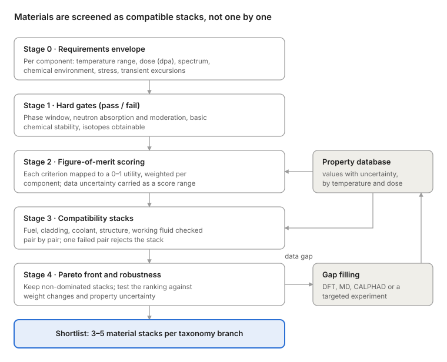

# Materials screening method

Materials pass through five stages. What gets selected is a **compatible stack** (fuel + cladding + coolant + structure + working fluid) for each design branch, not a single best material: at high temperature the interfaces fail before the bulk materials do. Material pages live in [materials/](../materials/README.md); their facts come from the [property database](../data/database.md) where possible.

| Stage | What happens |
| --- | --- |
| 0 Requirements envelope | Per component: temperature range, dose (dpa), spectrum, chemical environment, stress, transient excursions |
| 1 Hard gates | Pass/fail on phase window, neutron absorption and moderation, basic chemical stability, isotopes obtainable |
| 2 Figure-of-merit scoring | Each criterion mapped to a 0–1 utility, weighted per component; data uncertainty carried as a score range |
| 3 Compatibility stacks | Fuel, cladding, coolant, structure, working fluid checked pair by pair; one failed pair rejects the stack |
| 4 Pareto front and robustness | Non-dominated stacks kept; ranking tested against weight changes and property uncertainty |

When a missing property blocks a decision, it is filled by calculation or targeted measurement and fed back to the database. Nothing is ranked on a guessed value without an uncertainty attached.

## Components and what they must survive

| Component | Function | Environment (T3–T5) | Main failure modes |
| --- | --- | --- | --- |
| Fuel | Fissile and fertile host; holds fission products | Centre 1,200–2,000 °C; ≥ 15% FIMA | Swelling, fission-gas release, melting or decomposition, fuel–cladding interaction |
| Cladding / fuel container | First fission-product barrier | Coolant + 50–150 K; 100–200 dpa | Creep rupture, swelling, embrittlement, corrosion on both faces |
| Coolant | Heat transport | Full loop ΔT, high flux in core | Boiling or freezing, corrosion, activation, void reactivity |
| Core structures | Hold core geometry | Highest dose; replaceable | Swelling, irradiation creep, embrittlement |
| Vessel and primary boundary | Contain the coolant for plant life | Low dose; 40–60 years at coolant temperature | Thermal creep, creep-fatigue, corrosion |
| Reflector | Return neutrons, cut leakage | High fast flux | Swelling, parasitic capture |
| Shield | Protect vessel and HX | Moderate flux, high temperature | Heating, decomposition, activation |
| Absorber / control | Reactivity control and shutdown | High flux; helium from B-10(n,α) | Swelling, cracking, loss of worth |
| Heat exchanger | Transfer heat to the power cycle | Coolant one side, gas or process fluid other | Creep, two-sided corrosion, tritium permeation |

## Stage 1: hard gates

| Gate | Pass criterion (initial) | Applies to |
| --- | --- | --- |
| Melting / solidus | Solidus ≥ peak + 300 K (fuel) or + 200 K (others); structures at ≤ ~0.5 Tm (K) unless creep data justify more | All solids |
| Boiling / freezing | Boiling at system pressure ≥ peak + 300 K; melting ≤ inlet − 50 K | Coolants, fuel salts |
| Phase stability | No phase change in the window, or a tolerable one; no dissociation (e.g. UN → U + N2) | All |
| Eutectics | No liquid with any contacting material below peak + 100 K | Interfaces |
| Neutron absorption | Spectrum-averaged macroscopic absorption below the component's budget | In-core materials |
| Moderation | ξΣs below limit; no H, Be, C or Li-6 beyond trace in core | In-core materials |
| Chemical stability | No reaction with partners favoured by Gibbs energy, unless a self-limiting protective layer forms | Interfaces |
| Isotopic feasibility | Needed enrichment (N-15, Li-7, Cl-37, B-11) achievable by known separation physics | Enriched materials |

Activation products are flagged, not gated: Po-210 from Bi, C-14 from N-14, Cl-36 from Cl-35, tritium from Li, Co-60 from Co impurities.

## Stage 2: figures of merit

| Domain | Figure of merit | Measure | Better when | In database |
| --- | --- | --- | --- | --- |
| Neutronics | Parasitic absorption | Σa = N·σa, spectrum-averaged (MT 101) | Lower | Yes (`xs_avg`) |
| Neutronics | Moderation | ξΣs | Lower | ξ computed from masses |
| Neutronics | Damage and gas | dpa per fluence; He appm per dpa | Lower | (n,α) in `xs_avg` |
| Neutronics (fuel) | Heavy-metal density | g HM/cm³ | Higher | Manual |
| Thermal (fuel) | Linear power limit | q′max = 4π ∫k dT | Higher | Manual |
| Thermal (coolant) | Heat transport | ρcp; k | Higher | cp from JANAF; ρ, k manual |
| Thermal (coolant) | Pumping power per unit heat | ∝ μ^0.2 / (ρ² cp^2.8) | Lower | Manual |
| Mechanical | Creep strength | 10⁵ h rupture stress at temperature | Higher | Manual |
| Mechanical | Thermal-stress resistance | R = σy k (1 − ν) / (α E) | Higher | Manual |
| Mechanical | Expansion mismatch | \|α₁ − α₂\| × ΔT | Lower | Manual |
| Irradiation | Dimensional and ductility stability | Swelling (%/dpa), DBTT shift | Lower degradation | Manual |
| Chemistry | Corrosion; mass transfer | µm/year; dS/dT | Lower | Manual |
| Chemistry | Thermodynamic stability vs partner | ΔfG comparison (e.g. against Al2O3) | More stable | Yes (JANAF) |
| Phases | Margin to phase change | ΔT to nearest transition | Higher | Yes (JANAF) |
| Thermodynamics | Volatility | Vapour pressure at peak T | Lower | Yes (JANAF) |
| Data confidence | Evidence level | 1 measured under irradiation … 5 estimated | Higher | Source tier |

Scores combine as U_j = Σ w_i u_i(x_ij), with each property sampled from its uncertainty so each material gets a score distribution; ranking uses the median and 10th percentile.

Starting weights (%, each row sums to 100; for absorbers high absorption scores well):

| Component | Neutronics | Thermal | Mechanical | Irradiation | Chemistry | Phase margin | Data confidence |
| --- | --- | --- | --- | --- | --- | --- | --- |
| Fuel | 25 | 20 | 5 | 20 | 10 | 15 | 5 |
| Cladding | 15 | 5 | 20 | 25 | 20 | 10 | 5 |
| Coolant | 20 | 25 | 0 | 5 | 20 | 25 | 5 |
| Core structures | 20 | 5 | 20 | 30 | 15 | 5 | 5 |
| Vessel | 5 | 5 | 35 | 10 | 25 | 10 | 10 |
| Reflector | 40 | 5 | 5 | 20 | 20 | 5 | 5 |
| Absorber | 40 | 5 | 5 | 25 | 10 | 10 | 5 |
| Heat exchanger | 0 | 25 | 30 | 0 | 30 | 5 | 10 |

## Stage 3: compatibility stacks

Each interface pair is compatible, conditional (needs barrier, coating or impurity control) or incompatible; a stack's score is capped by its weakest interface. Known pairs (details on the material pages):

- Metal fuel / iron-based cladding: U–Fe and Pu–Fe eutectics ~650–725 °C.
- Lithium / nickel alloys: high Ni solubility; refractory metals needed, oxygen in Nb at ppm level.
- Lead / nickel and steels: Ni dissolves; steels need oxygen control and stop ~550 °C; Mo, W, SiC weakly soluble.
- Aluminium / almost every metal: aluminide formation ([aluminium](../materials/aluminium.md)).
- Chloride salt / alloys: Cr leaches, Mo resists; redox set by U(III)/U(IV).
- Helium impurities / nickel alloys: carburisation or decarburisation.
- Refractory metals / air: catastrophic oxidation above ~500 °C; inert guard volume needed.
- Nitride fuel / cladding: nitrogen transfer to Nb or Zr; dissociation at low N2 pressure.
- Fission products / cladding: Cs, Te, I attack at high burnup.

## Stage 4: Pareto front and robustness

Stacks are compared on neutronic penalty (ΔBR), maximum usable outlet temperature, component life margin and data confidence. Non-dominated stacks are kept; weights are perturbed ±50% and properties sampled within their uncertainties. A stack is shortlisted if it stays in the top quartile in ≥ 80% of samples.

## Initial long list

| Component | Long-list candidates | Early concerns |
| --- | --- | --- |
| Fuel | (U,Pu)N with N-15; (U,Pu)C; (U,Pu)O2; U-Pu-Zr; cermets UN–W, UN–Mo; NaCl–UCl3–PuCl3 with Cl-37; LiF–ThF4–UF4 with Li-7; liquid [U–Pu metal](../materials/uranium-plutonium-metal.md) | Nitride dissociation; carbide pyrophoric; oxide low conductivity |
| Cladding / walls | ODS FeCrAl, HT9/T91, 15-15Ti; Nb-1Zr; Mo-TZM, Mo-Re; Ta-10W; [W](../materials/tungsten.md), W-Re; SiC/SiC; [ZrB2](../materials/zirconium-diboride.md), [AlN](../materials/aluminium-nitride.md) | Steels stop at T2; refractory metals embrittle; Ta, W, Re capture neutrons |
| Coolant | [Pb](../materials/lead.md), Pb-Bi, Li-7, Sn, [Al](../materials/aluminium.md), He, CO2, chloride salts; [Ca](../materials/calcium.md), [CaF2](../materials/calcium-fluoride.md) as direct-contact carriers | See material pages |
| Core structures | As cladding, plus ZrC and SiC | Swelling at 100–200 dpa |
| Vessel | 316H, Alloy 800H, 617, 230, Haynes 282, Hastelloy N, Grade 91; refractory-lined steel | Alloy 617 rated to ~950 °C; cold-vessel layout widens options |
| Liners | [Y2O3](../materials/yttria.md), [ThO2](../materials/thoria.md), [Al2O3](../materials/alumina.md) | Low conductivity |
| Reflector | Pb, steel, Mo, Zr, MgO, W | BeO and graphite excluded |
| Absorber | B4C (B-10 enriched), Eu2O3, Ta, Hf | B4C helium swelling |
| Heat exchanger | Alloy 617, Haynes 230/282, SiC ceramic, AlN, diborides | Two-sided corrosion, tritium permeation |
| Working fluid | He, N2, sCO2, steam | sCO2 carburisation; steam–coolant reactions (Li, Na, Al) |
