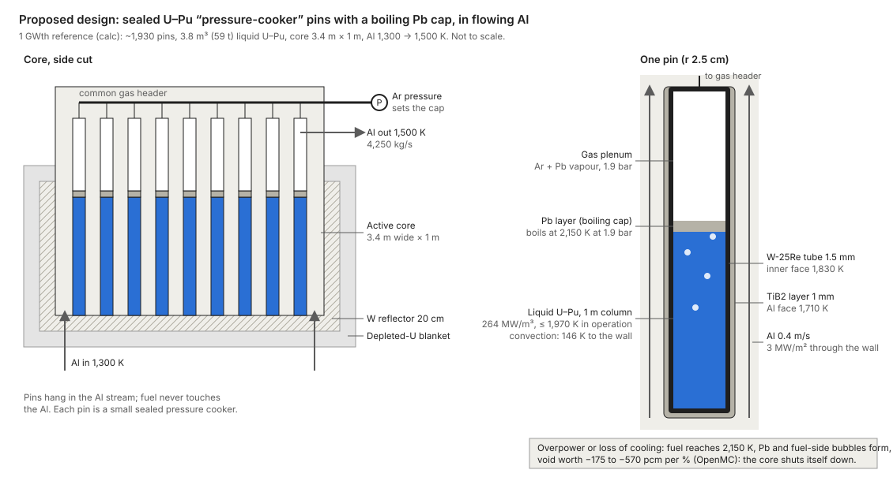

# Study: boiling-capped "pressure-cooker" reactor cooled by aluminium

**Status:** proposal, first analysis (2026-11-22). Concept from the project lead: fuel in sealed vessels at its boiling point, cooled from outside by liquid aluminium, relying on a negative void coefficient. Target ~1 GWth. Code: [`analysis/boiling-pool/`](../../analysis/boiling-pool/) (`model.py` physics, `design.py` reference sizing, `study.py` option scans, `neutronics.py` and `design_neutronics.py` OpenMC). Numbers are *(calc)* unless marked; vapour data are *(db)* (NIST-JANAF); liquid properties, creep strengths and actinide vapour data are *(approx.)* ([Q-060–Q-063](../open-questions.md)).

## Proposal

**About 1,930 small sealed vessels ("pins") of liquid U–Pu metal, each with a thin layer of lead floating on the fuel and a gas plenum above it, hang in a stream of liquid aluminium.**
- **Heat path:** heat leaves each pin by natural convection inside the fuel and conduction through a W-25Re tube clad in TiB2.
- **The cap:** the pins share a gas header, and its argon pressure sets the boiling point of the lead. In operation the fuel stays below that point. On overpower or loss of cooling the fuel reaches it, bubbles form, and the void (−175 to −570 pcm per percent) shuts the core down. **Boiling is the thermostat, not the heat path.**



### Reference design at 1 GWth

| Item | Value | Basis |
| --- | --- | --- |
| Pins | ~1,930; fuel radius 2.5 cm, 1 m fuel column, outer radius 27.5 mm, pitch 69 mm | Sized for 3 MW/m² at the tube surface |
| Fuel | Liquid U–Pu metal, Pu ≈ 10.5% (critical, clean), 3.8 m³ (59 t, ~6.2 t Pu), 264 MW/m³ in the fuel | OpenMC check below |
| Core | 3.4 m diameter × 1 m, fuel fraction 0.42; 20 cm W reflector, then a depleted-U blanket | `design.py` |
| Fuel temperature | ≤ 1,970 K in operation (146 K convective drop to the wall) | Internally heated cylinder, Nu = 0.34 Ra^0.226 *(approx.)* |
| Temperature cap | Pb boils at 2,050 / 2,150 / 2,250 / 2,350 K at 1.2 / 1.9 / 3.0 / 4.5 bar *(db, Pb above its 1 bar boiling point by Clausius–Clapeyron)* | Reference: 2,150 K at 1.9 bar, 180 K above the hottest fuel |
| Tube wall | W-25Re 1.5 mm, inner face 1,830 K; TiB2 1 mm, Al face 1,713 K | All checks pass: hoop 5.5 MPa vs 62 allowed; metal thermal stress 87 MPa vs 187; TiB2 thermal stress 105 vs 150 MPa; Al face below TiB2's ~1,950 K dissolution limit |
| Aluminium | 1,300 → 1,500 K (1,027–1,227 °C), 4,250 kg/s, 0.42 m/s; film h ≈ 14 kW/m²K | Liquid-metal Nusselt correlation |
| Delivered heat | ~1,200 °C | Set by the aluminium outlet |

## How the cap works

Boiling pins fuel temperature to the saturation temperature at the vessel pressure. In this design the lead layer, and any lead dissolved in the fuel, boils first.
- **Below the set point:** the pins behave like any convecting liquid-fuel core, and power follows heat removal.
- **At the set point:** vapour forms in the hottest fuel. Fuel mass is fixed, so the liquid swells upward and its density in the core falls. OpenMC puts that at **−175 to −570 pcm per percent of void**. 10% void is worth 4–10 β, far more than any credible reactivity insertion.
- **The set point is a control:** raising the argon pressure raises the cap. The operator chooses how hot the fuel may get, and a valve, not a mechanism inside the core, enforces it.

Boiling as a thermostat answers [Q-052](../open-questions.md). Liquid U–Pu had almost no prompt feedback: Doppler is about zero, and expansion is weak in large cores ([core-thermal](core-thermal.md), [geometry](geometry-by-phase.md#refinement-with-the-core-thermal-model-2026-11-21) studies). A boiling cap gives one more than ten times stronger.

### Void reactivity (OpenMC)

Bubbles displace fuel at constant fuel mass: density × (1 − α), column height ÷ (1 − α). ENDF/B-VIII.0, σ ≈ 60–80 pcm:

| Pool | Size | Void 10% | 20% | 30% | Per % void |
| --- | --- | --- | --- | --- | --- |
| Liquid U–Pu, Pu 15%, 20 cm W reflector | R 16 cm, H 32 cm (critical) | −4,400 pcm | −9,900 | −17,100 | −440 to −570 |
| Large core: 45% liquid U–Pu (Pu 10%) + 10% W, W reflector | R 1.5 m, H 3 m | −1,750 | −4,300 | −7,400 | −175 to −250 |
| NaCl–(U,Pu)Cl3 30/70 (alternative fuel, Cl-37 99%), Pb reflector | R 1.5 m, H 3 m | −2,700 | −6,500 | −11,200 | −270 to −370 |

**Reference core** (`design_neutronics.py`, homogenised pins + tube walls + Al, 20 cm W reflector, 30 cm depleted-U blanket, OpenMC):
- **Critical Pu fraction:** about 10.5%. k = 0.974 at Pu 10% and 1.273 at Pu 16%, so about 6.2 t of Pu (4.3 t fissile) in 59 t of fuel, with no burnup margin.
- **Void worth at Pu 10.5%:** −1,180 pcm at 5%, −2,570 at 10%, −5,450 at 20%, i.e. **about −240 to −270 pcm per % void** (σ ≈ 80 pcm). That is about 2.5 β at 5% void and 5–6 β at 10%.

## The vessel (the pin tube)

### Hot wall: W-25Re with a TiB2 outer layer (reference)

Every refractory metal forms aluminides with liquid aluminium, so the tube has two layers.
- **Fuel side:** a refractory metal carries the pressure and holds the fuel.
- **Aluminium side:** a 1 mm ceramic layer keeps the aluminium off the metal. A-family Phase 1 put each ceramic's dissolution limit in aluminium at about 1,770 K for ZrB2, 1,840 K for AlN and 1,950 K for TiB2 ([aluminium study](aluminium-coolant.md)).

Each wall is checked four ways:
- hoop stress P·r/t at most ⅔ of the 10⁴ h creep-rupture strength *(approx.)*;
- metal thermal stress at most 3× that, since it relaxes;
- ceramic thermal stress at most half the ceramic's fracture strength;
- aluminium-side face below the barrier's dissolution limit.

Largest heat flux through the wall, with fuel at 2,000 K, aluminium at 1,500 K and a TiB2 barrier (metal thickness optimised):

| Material | r = 2.5 cm (pins) | r = 25 cm | r = 1.5 m (one big vessel) | Notes |
| --- | --- | --- | --- | --- |
| W | 4.3 MW/m² (barrier stress) | 2.5 (metal thermal stress) | 1.9 (Al-side temperature) | W–U mass transfer open ([Q-021](../open-questions.md)) |
| **W-25Re** | **4.3** | **4.3** | 0.85 | Ductile at room temperature; reference |
| Mo (TZM) | 4.3 | fails (creep) | 0.34 | |
| Ta-10W | 4.2 | fails | 0.11 | Attacked by oxidising chloride salt |
| Re | 4.3 | 2.2 | 0.35 | Strong absorber, costly |
| Nb-1Zr | fails | fails | fails | Too weak above ~1,500 K |

At pin size the metal is not the limit: thermal stress in the **TiB2 barrier** caps the flux at ~4.3 MW/m². The reference design runs at 3 MW/m². That is why the design uses many small pins rather than one large vessel.

### Cold wall with a frozen-fuel skull (variant)

If the tube's inner face is kept below the fuel's solidus (~1,380 K *(approx.)*), a crust of frozen fuel forms on it. The wall then touches only solid fuel at its own temperature, and any refractory metal holds the pressure easily. Heat must still flow downhill, so the aluminium runs below the solidus by the wall's temperature drop. Mo-TZM 2 mm, TiB2 1 mm, h_Al 50 kW/m²K:

| Wall heat flux | Wall inner face | Skull | Highest Al bulk temperature |
| --- | --- | --- | --- |
| 0.5 MW/m² | 1,300 K | 4.8 mm | 1,270 K (≈1,000 °C) |
| 1 MW/m² | 1,300 K | 2.4 mm | 1,240 K (≈970 °C) |
| 2 MW/m² | 1,300 K | 1.2 mm | 1,180 K (≈910 °C) |
| 3 MW/m² | 1,300 K | 0.8 mm | 1,120 K (≈850 °C) |

**The skull variant trades delivery temperature for robustness.**
- **What it buys:** liquid uranium never touches the wall ([Q-021](../open-questions.md) disappears), and pressure is no longer a constraint.
- **What it costs:** heat is delivered at about 850–1,000 °C, capped by the fuel's melting point, against about 1,200 °C for the hot-wall reference.

A higher-melting fuel would lift that ceiling. Thorium metal freezes at 2,023 K *(db)*, and UN, UO2 and MOX at about 3,000–3,100 K *(approx.)*. With those fuels, the aluminium-side barrier becomes the limit instead. Thorium is the weaker fast breeder. In an infinite medium at 2,100 K *(calc, OpenMC)*, Th + U-233 8% with equilibrium Pa-233 (0.5% of the Th, now in the library) gives k∞ 1.25 at conversion ratio 0.93. Pa-233 takes 1.1% of absorptions. U + Pu 9% gives k∞ 1.38 at conversion ratio 1.30. At equal reactivity U–Pu converts about 40% better, so a thorium skull buys delivery temperature at the cost of breeding.

## Risks and open questions

| Risk | Why it matters | Next step |
| --- | --- | --- |
| Boiling instabilities near the set point (chugging, geysering, density waves) | The cap must act smoothly, not oscillate | Coupled boiling-kinetics model ([Q-062](../open-questions.md)) |
| W–U interaction at 1,830 K for years | Tube life | Capsule tests ([Q-021](../open-questions.md), [Q-030](../open-questions.md)) |
| Pb in contact with U–Pu: mutual solubility; Pu carried into the vapour | Fuel composition drift, Pu in the plenum | CALPHAD with actinides ([Q-014](../open-questions.md)), [Q-020](../open-questions.md) |
| TiB2 layer in flowing Al at 1,713 K: dissolution rate, cracking under thermal cycling | Barrier life; one crack exposes W to Al | Dissolution-kinetics tests ([Q-036](../open-questions.md)) |
| Fission gases (Kr, Xe) accumulate in the plenum | Pressure rises and shifts the cap | Vent through the common header with a gas clean-up loop |
| Positive Al void worth (A2-like cores: +5,000 pcm) | Losing Al from around the pins adds reactivity | OpenMC Al-void case for this core |
| Creep data for W-Re at 1,800–1,900 K | Wall allowables are order-of-magnitude | [Q-061](../open-questions.md) |

## Alternatives considered

### Mode A: let boiling carry the heat

Here the fuel boils in operation and all heat leaves as vapour that condenses on the Al-cooled walls. **Rejected: the vapour is too light.** At the 1–3 bar these fuels boil at near 2,000 K, a cubic metre of vapour carries only 0.7–2.7 MJ. A boiling-water reactor's steam at 70 bar carries ~55 MJ.

| Boiling system at 2,000 K | Pressure | Vapour density | Latent heat | Heat per m³ of vapour | Power density at 30% void, 1 m pool | Fuel per GW |
| --- | --- | --- | --- | --- | --- | --- |
| NaCl–(U,Pu)Cl3, 30% NaCl | 0.99 bar | 0.36 kg/m³ | 2.58 MJ/kg | 0.94 MJ/m³ | 0.16 MW/m³ | 6,200 m³ |
| NaCl–(U,Pu)Cl3, 50% NaCl | 1.7 bar | 0.64 | 2.50 | 1.60 | 0.28 | 3,500 m³ |
| ⁷LiF–(U,Pu)F4, 60% LiF | 0.55 bar | 0.11 | 6.42 | 0.68 | 0.12 | 8,300 m³ |
| U–Pu under boiling Pb | 0.91 bar | 1.14 | 0.86 | 0.97 | 0.21 | 4,700 m³ |
| U–Pu under boiling Ca | 3.1 bar | 0.75 | 3.64 | 2.72 | 0.97 | 1,000 m³ |
| U–Pu under boiling Mg | 31.9 bar | 4.67 | 4.91 | 22.9 | 8.7 | 115 m³ |
| U–Pu metal itself, 3,500 K (Pu vapour) | 0.15 bar | 0.12 | 1.39 | 0.17 | 0.05 | ~20,000 m³ |

Vapour data are from JANAF (monomer, dimer and trimer) *(db)*. Actinide salts are taken as non-volatile, with Raoult's law for the solvent *(approx.)*. Void comes from drift flux (Zuber–Findlay, churn-turbulent) with all heat leaving as vapour. Pumping the liquid upward, as a BWR does, raises the figures ~10–20×, still far below a fast core's 200–900 MW/m³. The magnesium carrier comes closest, but its 32 bar at 2,000 K is beyond any hot wall.

Mode A architectures for 1 GW (chloride, 2,000 K, W-25Re + TiB2, Al at 1,500 K):

| Architecture | Limits | Result |
| --- | --- | --- |
| One vessel, R 1.0 / 1.5 / 2.5 m, Al outside | Wall 21 / 44 / 113 MW; flooding (Faghri et al. 1989 *(approx.)*) 105 / 237 / 659 MW; void ≤ 30%: 0.5 / 1.1 / 3.1 MW | Cannot reach 1 GW |
| Sealed boiling pins, r 2.5–5 cm | Void: 0.3–1.3 kW per pin | 0.8–3.2 million pins, 1,900–6,200 m³ of fuel |
| One boiler, vapour piped to Al-cooled condensers outside the core | Void at the pool | 1,900–6,200 m³ of fuel, a pool ~90 m across |

### Fuel salt instead of metal

NaCl–(U,Pu)Cl3 or ⁷LiF–(U,Pu)F4, with the solvent as the boiling component. **Rejected for this concept: salt conducts heat about 100× worse than U–Pu metal.** In thermostat mode, fuel-to-wall drops reach 360 K at 1 cm gaps and 50 MW/m³, needing ~2,000 m² of wall per GW; metal needs 250–500 m². In Mode A, salts suffer the vapour limit above. Their void worth is strongly negative, so the idea is sound, but the heat path is not.

### One large vessel

**Rejected.** A vessel of radius 1–2.5 m has only 25–130 m² of outside wall, which carries 20–110 MW at the wall limit. At that radius only W or W-25Re hold the pressure near 2,000 K, and the wall flux falls to 0.85–1.9 MW/m². The design therefore uses many small vessels.

### Skull-cooled boiling U–Pu at ~3,500 K

A frozen-fuel skull would let liquid U–Pu itself boil inside a cooled vessel. **Rejected as a heat path:** Pu vapour at 3,500 K carries only 0.17 MJ/m³. The heat also leaves below the fuel's melting point, so the 3,500 K buys nothing in delivered temperature. The skull survives as the cold-wall variant above.

## How to run

```bash
cd analysis/boiling-pool
/opt/mamba/envs/nuc/bin/python design.py             # reference pin core sizing
/opt/mamba/envs/nuc/bin/python study.py              # vapour, power density, walls, architectures, skull, thermostat
/opt/mamba/envs/nuc/bin/python neutronics.py         # OpenMC void worths of simple pools (~20 min)
/opt/mamba/envs/nuc/bin/python design_neutronics.py  # OpenMC critical Pu and void worth of the reference core
```
