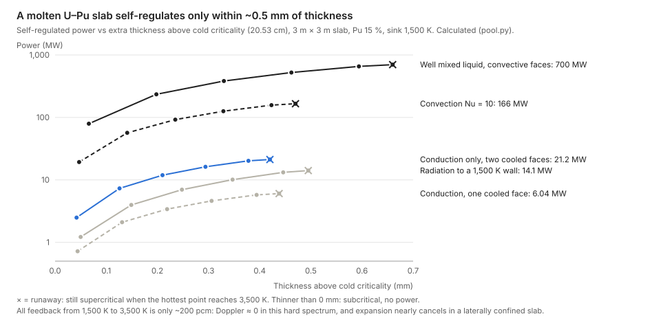

# Study: core nuclear-thermal behaviour, chemistry set aside

**Status:** first results (2026-11-21). Chemistry and corrosion are deliberately ignored here: walls survive whatever they touch, so the limits are nuclear and thermal only.

**Question.** For a given fissile density and set of conditions, how much heat does the core make, how hot does it get, and how much must the coolant carry away? Two programs answer it:

- [`pool.py`](../../analysis/core-thermal/pool.py) handles **simple bodies of molten U–Pu**: a slab, sphere or cylinder of any size and Pu fraction, bare or reflected, with one of four heat-removal options. It finds the power at which the body's own temperature feedback holds it exactly critical.
- [`simulate.py`](../../analysis/core-thermal/simulate.py) handles **reactor cores**: homogenised lattices of pins, particles, pools and tubes, sized for a target power. It gives the critical Pu fraction, temperatures, coolant flow, feedback coefficients and standard transients.

All numbers are *(calc)* from those scripts unless marked. Properties marked *(approx.)* in [`props.py`](../../analysis/core-thermal/props.py) are handbook correlations not yet entered in the database ([Q-050](../open-questions.md)).

## The physics in one paragraph

**Fissile density does not set the power of a critical reactor.** A critical chain reaction runs at any power: the neutron population grows until something stops it. Fissile density sets how big the body must be to go critical, and how much flux each watt needs. The power is then set by two things: how much heat the removal path can carry at a tolerable temperature, and the **temperature feedback**. With a negative temperature coefficient, a body that is too cold is supercritical, so it heats up. A body that is too hot is subcritical, so it cools down. It settles at the temperature where it is exactly critical, and makes exactly as much heat as the coolant removes at that temperature. That equilibrium is what `pool.py` computes. It only exists if the feedback available between the coolant temperature and the temperature limit is larger than the body's cold excess reactivity. **That turns out to be the binding constraint for liquid metal fuel.**

## Model

| Step | Method | Source |
| --- | --- | --- |
| Neutron constants | One-group cross sections per nuclide (81 fine groups collapsed with one spectrum, so that statistical noise cannot pose as Doppler); four reference spectra: pure U–Pu metal, metal/Pb/W, nitride/Al/W, oxide/Na/steel; 1,200 and 2,100 K | OpenMC on ENDF/B-VIII.0 ([`constants.py`](../../analysis/core-thermal/constants.py)) |
| Energy per fission and per capture | Recoverable energy (MF1/MT458) and (n,γ) Q-values | ENDF/B-VIII.0 |
| Delayed neutrons | Six groups per nuclide, weighted by fission rate | ENDF/B-VIII.0 via OpenMC tallies |
| Criticality | One-group diffusion: bare or reflected sphere, cylinder, slab. For simple bodies, k_eff is **anchored to an OpenMC run of the same body** at the cold state; the one-group model supplies only the temperature dependence | [`neutronics.py`](../../analysis/core-thermal/neutronics.py), [`pool.py`](../../analysis/core-thermal/pool.py) |
| Heat path | Conductivity integral through the fuel (slab, cylinder, sphere, annulus); bonded, gap or radiative interface; wall; film coefficient from liquid-metal or Dittus–Boelter correlations; chopped-cosine axial shape; hot-channel factor from the radial flux mode | [`thermal.py`](../../analysis/core-thermal/thermal.py) |
| Power limit | Largest power density that keeps the hottest fuel and wall below their limits, with coolant velocity capped | [`core.py`](../../analysis/core-thermal/core.py) |
| Feedback | Doppler (fuel temperature), fuel expansion, coolant density and void, by finite differences of the same model | same |
| Transients | Point kinetics (6 delayed groups) with lumped fuel, coolant and pool temperatures, plus decay heat (Way–Wigner *(approx.)*, [Q-051](../open-questions.md)) | [`kinetics.py`](../../analysis/core-thermal/kinetics.py), [`pool.py`](../../analysis/core-thermal/pool.py) |

## Simple bodies of molten U–Pu (`pool.py`)

### Reactivity budget

A pure molten U–Pu body has a very hard spectrum: median flux energy about 290 keV *(calc)*. Very few neutrons reach the resonance region, so **Doppler feedback is almost nil**, about −0.01 pcm/K *(calc, at the noise level of the constants)*. That leaves thermal expansion as the only prompt feedback, and its strength depends on shape:

| Body | Expansion feedback | Total feedback from 1,500 K to 3,500 K *(calc)* |
| --- | --- | --- |
| Slab 3 m × 3 m, sides confined | Thickness grows as density falls, so the product nearly cancels; only side leakage changes: −0.07 to −0.10 pcm/K | **≈ −200 pcm** (Pu 15%); −150 (Pu 20%) to −315 (Pu 10%) |
| Free sphere, bare | Radius grows as density falls; leakage rises | ≈ −6,300 pcm |
| Sphere with 20 cm W reflector | As above, partly masked by the reflector | ≈ −3,400 pcm |
| Cylinder H/D = 1, radius fixed | Height grows | ≈ −6,600 pcm |

Each millimetre of extra slab thickness adds roughly 250 pcm (Pu 10%) to 650 pcm (Pu 20%). So the stable range is tiny.

### The self-regulating window



Reference slab: 3 m × 3 m, Pu 15%, sink at 1,500 K. Limit: hottest point 3,500 K (boiling, *(approx.)*). k_eff anchored to OpenMC with 40,000 × 70 histories (σ ≈ 30 pcm).

| Case | Critical at (cm) | Runaway above (cm) | Window | Max self-regulated power | Fuel mass |
| --- | --- | --- | --- | --- | --- |
| Pu 10%, conduction, two cooled faces (h = 20 kW/m²K) | 29.77 | 29.90 | 1.2 mm (0.41%) | 15 MW | 46 t |
| **Pu 15%, same** | **20.53** | **20.58** | **0.42 mm (0.21%)** | **21 MW** | **32 t** |
| Pu 20%, same | 16.25 | 16.27 | 0.23 mm (0.14%) | 27 MW | 25 t |
| Pu 15%, well-mixed liquid | 20.53 | 20.60 | 0.66 mm | 700 MW | 32 t |
| Pu 15%, convection Nu = 10 | 20.53 | 20.58 | 0.47 mm | 166 MW | 32 t |
| Pu 15%, one cooled face | 20.53 | 20.58 | 0.44 mm | 6 MW | 32 t |
| Pu 15%, radiation to a 1,500 K wall (ε 0.8) | 20.53 | 20.58 | 0.50 mm | 14 MW | 32 t |
| Pu 15%, radiation to a 1,000 K wall | 20.51 | 20.56 | 0.53 mm | 15 MW | 32 t |
| Pu 15%, no heat removal | 20.53 | — | — | 0 (settles near 1,900 °C mid-window) | 32 t |
| Sphere, bare, Pu 15%, conduction | 23.03 (radius) | 23.65 | 6.2 mm (2.7%) | 0.3 MW | 0.9 t |
| Sphere, W reflector 20 cm | 15.32 | 15.82 | 5.0 mm (3.3%) | 0.3 MW | 0.3 t |
| Cylinder H/D = 1, conduction | 20.87 (radius) | 21.70 | 8.3 mm (4.0%) | 0.3 MW | 1.0 t |

**Assembly transient.** The Pu 15% slab is assembled cold at mid-window, inserting 63 pcm (0.13 $). It heats over several minutes and settles at 11.3 MW and a power-weighted temperature of ~1,920 °C, without overshoot. The steady solver gives 11.9 MW for the same body. Larger insertions overshoot and, beyond the window, never settle.

**What this means:**

1. **A molten-metal body cannot hold itself at power by its own feedback in any practical sense.** The slab window is 0.2–1.2 mm. Nuclear-data uncertainty alone is several hundred pcm, wider than the whole feedback budget. Fuel burnup, fission-product build-up and Pu ingrowth move reactivity by thousands of pcm. Every liquid-metal-fuel design (A2, X1–X3, R1–R3) therefore needs **active reactivity control with more authority than the feedback**: rods, a movable reflector, or a fuel-level or drain system. It also needs **an engineered prompt feedback**. Candidates are free-surface or bellows expansion that lets fuel rise out of the core, gas voiding, and a dilute diluent with real Doppler.
2. **Shape changes feedback by 30×.** Bodies that expand in the direction of leakage (free spheres, height-growing cylinders) have −3,000 to −6,600 pcm of feedback before boiling. Laterally confined slabs have ~−200. In a liquid-fuel core, the expansion path is a design choice with large safety consequences.
3. **Heat removal sets the power, not the fissile density.** At identical criticality, the same slab makes 6 MW with one conduction-cooled face and 700 MW well mixed. Liquid-fuel cores need forced or strong natural circulation inside the fuel, or a fine subdivision (pins, tubes, R-family layers), to reach reactor-scale power.
4. **Small bodies are conduction-starved.** A critical sphere or cylinder of 20–23 cm radius can shed only ~0.3 MW by conduction, because power scales with volume but conduction scales with size. Higher Pu fractions shrink the body further and worsen this.

## Reactor cores at 1,000 MWth (`simulate.py`)

Design mode works the way a core is actually sized. First the core is sized so that the hottest fuel and wall sit at their limits (or the coolant at its velocity cap). Then the Pu fraction is found that makes that core critical (k_eff = 1, no burnup margin). Cylinder H/D = 1, homogenised, with reflector.

| Case | Pu fraction | Core volume | Fissile mass | Core-average power density | Peak fuel | Peak wall | Peak wall heat flux | Coolant flow | Core pumping |
| --- | --- | --- | --- | --- | --- | --- | --- | --- | --- |
| MOX pins / Na (SFR anchor) | 13.3% | 4.1 m³ | 1.4 t | 246 MW/m³ | 2,308 °C | 570 °C | 1.7 MW/m² | 5,260 kg/s, 8.1 m/s | 0.06% |
| (U,Pu)N pins / Pb, 900→1,200 °C | 12.3% | 4.9 m³ | 2.2 t | 203 | 1,253 | 1,214 | 1.2 | 24,100 kg/s, 3.1 m/s | 0.06% |
| (U,Pu)N particles / He 7 MPa, 600→1,100 °C | 10.5% | 23 m³ | 7.8 t | 43 | 1,102 | 1,101 | 0.03 | 385 kg/s, 64 m/s | **15%** |
| Liquid U–Pu pool / Al in W tubes (A2-like), 1,300→1,600 °C | 13.8% | 1.1 m³ | 0.7 t | 944 | 1,975 | 1,732 | **13 MW/m²** | 2,830 kg/s, 5.9 m/s | 0.01% |
| Liquid U–Pu, radiative gap to He tubes (R3-like) | 7.3% | 69 m³ | 26 t | 15 | 1,735 | 1,361 | 0.44 | 480 kg/s, 62 m/s | 0.5% |
| Liquid U–Pu, radiative gap to Al tubes (R1-like) | 10.2% | 34 m³ | 18 t | 29 | 2,104 | 1,606 | 0.91 | 2,830 kg/s | ~0 |
| Circulating liquid U–Pu (fuel is the coolant), 1,700→2,000 °C | 11.4% | 3.3 m³ | 2.6 t | 300 (cap) | 2,000 | — | — | 17,500 kg/s of fuel | — |

**Feedback and kinetics** at the same points *(calc)*:

| Case | Doppler T·dk/dT | Fuel expansion | Coolant density | Full coolant void | β_eff | Λ |
| --- | --- | --- | --- | --- | --- | --- |
| MOX / Na | −1,708 pcm | −0.79 pcm/K | +0.19 pcm/K | +650 pcm | 450 pcm | 0.61 µs |
| UN / Pb | −528 | −0.77 | −0.05 | −1,310 | 474 | 0.36 |
| UN / He | −2,162 | −0.42 | +0.05 | +70 | 494 | 0.61 |
| A2-like (U–Pu / Al) | −289 | −2.2 | +0.42 | **+4,970** | 454 | 0.20 |
| R3-like (U–Pu / He) | −365 | −1.24 | +0.26 | +390 | 593 | 0.30 |
| R1-like (U–Pu / Al) | −461 | −1.62 | +1.12 | **+12,760** | 512 | 0.26 |
| Circulating U–Pu | −167 | −2.1 | — | — | 270 (55% retained) | 0.15 |

**Coolant per unit of heat.** Carrying 1,000 MW across a 300 K rise takes 2,830 kg/s of aluminium (1.3 m³/s), 24,100 kg/s of lead (2.5 m³/s) or, across 500 K, 385 kg/s of helium (128 m³/s at 7 MPa). Lead needs the most mass and helium the most volume. Helium's core pumping power (15% of thermal at a 64 m/s cap) is the gas-cooled penalty.

**Transients** (unprotected, from 1,000 MWth, no scram; pool heat capacity 20× the in-core coolant *(approx.)*):

| Case | +0.5 $ step | Loss of flow (to 5%) | Loss of heat sink | Scram + total loss of flow and sink |
| --- | --- | --- | --- | --- |
| MOX / Na | settles at 1.12× power | **Na boils at 67 s** | **Na boils at 50 s** | Na boils at 2 s |
| UN / Pb | 1.41×, fuel 1,337 °C | settles at 8% power, outlet 1,263 °C | fuel 1,551 °C, power → 1.3% | fuel limit at 458 s |
| UN / He | 1.17× | 7% power | stays below 1,100 °C | survives the hour (1,822 °C) |
| A2-like | 1.20× | 10% power | **fuel limit at 241 s** | fuel limit at 30 s |
| R3-like | 1.39× (peak 3.6×) | 7% power | 1,381 °C | survives (1,615 °C) |
| R1-like | 1.43× | 12% power, fuel 1,961 °C | 1,962 °C | survives (2,018 °C) |

**What this means:**

1. **Radiative coupling's price is confirmed independently.** At 15–29 MW/m³, the R-family cores need 34–69 m³ and 18–26 t of fissile Pu for 1,000 MWth. That is 25–35× A2's inventory, consistent with the scoping study's 15 m³ for R1 with a hotter, coated tube. The large heat capacity per watt is also why R1 and R3 ride out total loss of cooling for an hour.
2. **A2's heat flux is extreme.** A pool sized at the 2,100 °C fuel limit runs 13 MW/m² through the tube wall, four times the 3 MW/m² that A2's design page treats as its ceiling. With the wall heat flux capped, A2 grows toward the radiative family's size. Its small heat capacity also gives it the shortest time to the fuel limit when cooling is lost (30 s).
3. **Aluminium coolant brings a large positive void worth** in fast cores: +5,000 pcm (A2-like) and +12,800 pcm (R1-like, large core). This matches the R1 page's +3,000 pcm order of magnitude in an infinite medium. Voiding must be made physically impossible, or the core flattened to leak more. Lead gives a negative void worth.
4. **Circulating fuel loses 45% of its delayed neutrons** at a 1:1 loop-to-core volume (β_eff 270 pcm). Less than one dollar of margin is then left for control.

## Validation

| Check | Result |
| --- | --- |
| Godiva (bare HEU sphere, ICSBEP HEU-MET-FAST-001, R = 8.74 cm) | One-group model gives 8.41 cm (−3.7%), harder than any reference spectrum; OpenMC library itself gives k = 1.0002 ([database](../data/database.md)) |
| Simple U–Pu bodies, plain diffusion vs OpenMC (11 slabs, spheres and cylinders) | Diffusion overstates leakage of small fast-metal bodies by up to ~12,000 pcm. Fitted leakage factor 0.94 and extrapolation 3.55 D leave 2,100 pcm rms (3,500 max), which is why `pool.py` anchors k_eff to OpenMC |
| Core k∞, one-group vs OpenMC (7 cases) | One-group low by 2,000–7,600 pcm (spectrum interpolation between references); conversion ratio within 0.03–0.06 |
| Finite 1,000 MWth cores, OpenMC on the model's geometry and Pu fraction | k_eff 0.992 (MOX/Na), 1.010 (UN/Pb), 1.022 (A2-like): the critical Pu fraction is good to ~±0.5 point |
| Elastic P1 moment, data-derived vs analog tally | Median ratio 0.98 (range 0.8–1.6 on minor nuclides) |
| Transient vs steady state (slab) | 11.3 vs 11.9 MW at the same body |

**Limits.** One group, homogenised cores (no self-shielding between fuel and coolant), no burnup or fission products, lumped transients with instantaneous expansion (no inertia), no phase change (temperature results past boiling or melting are meaningless, so the times to the limits are reported instead). Decay heat is Way–Wigner. Doppler for hard metal spectra is at the noise level of the constants. MOX Doppler (−1,700 pcm) is above the usual SFR range (roughly −700 to −1,000 *(approx.)*).

## Open questions raised

- [Q-050](../open-questions.md): enter the thermophysical correlations (liquid U–Pu density, conductivity and heat capacity; coolant properties) into the database with locators.
- [Q-051](../open-questions.md): replace Way–Wigner with ANS-5.1 or a summation from ENDF decay and fission-yield data.
- [Q-052](../open-questions.md): control and engineered feedback for liquid-metal fuel. What mechanism gives more than ~1,000 pcm of prompt negative feedback in a laterally confined pool, and what control authority covers burnup?
- [Q-053](../open-questions.md): a multigroup spectrum solve per composition, replacing interpolation between reference spectra (k∞ errors of 2,000–7,600 pcm).

## How to run

```bash
cd analysis/core-thermal
/opt/mamba/envs/nuc/bin/python pool.py --shape slab --size 20.55 --width 300 --pu 0.15 --removal convective --h 20000 --Tc 1500 --transport
/opt/mamba/envs/nuc/bin/python pool.py window --shape sphere --pu 0.15 --removal radiative --eps 0.8 --Tc 1500 --transport
/opt/mamba/envs/nuc/bin/python pool.py transient --shape slab --size 20.55 --width 300 --pu 0.15 --transport
/opt/mamba/envs/nuc/bin/python simulate.py steady UN-Pb --power 1000
```

Without `--transport`, `pool.py` runs in fast mode (calibrated diffusion, ±2,000 pcm). The constants must exist first: run `constants.py` once, about 1–2 h. `run_study.sh` regenerates every result on this page.
