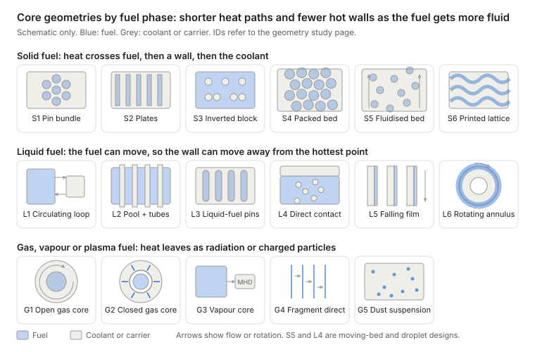
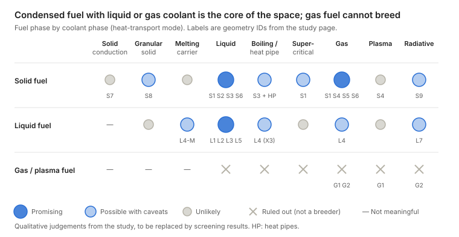

# Study: core geometry by phase of matter

**Status:** ideation (2026-11-20); refined with the core-thermal model, feedback and reflectors (2026-11-21). Nothing here is a design yet; [Q-006](../open-questions.md) asks which geometries to develop into design pages.

Geometry decides how far heat must travel through the fuel, how many walls sit at peak temperature, how much coolant dilutes the core (and so the spectrum and breeding), and whether delayed neutrons stay in the core. This page lists the geometries open to each fuel phase, then crosses them with the phase of the coolant (nine heat-transport modes), with what each combination buys and costs for a high-temperature breeder. The taxonomy so far ([axes 1–10](../framework/taxonomy.md)) records fuel chemistry and coolant but not geometry; a proposed eleventh axis is at the end.

## What geometry controls

| Quantity | Why it matters here | Geometry lever |
| --- | --- | --- |
| Heat path in the fuel | Peak fuel temperature, so how hot the coolant can be | Smaller pins, thinner plates, particles, liquid stirring |
| Walls at peak temperature | The hottest wall is usually the life-limiting part ([A2](../designs/A2.md#feasibility-scorecard)) | Fewer walls, walls away from the hottest point, or none (direct contact) |
| Coolant (or void) fraction in the core | Dilutes fuel and softens the spectrum, cutting breeding ratio; changes void reactivity | Tight lattices, dense beds, stationary pools |
| Delayed-neutron retention | Pu-239 has β ≈ 0.0021; precursors swept out of the core thin the control margin further | Keep fuel in the core (pools, pins); avoid fast external loops |
| Feedback | Prompt negative feedback limits transients | Liquid expansion, bed expansion, Doppler |
| Refuelling and processing | Burnup limit, poison removal, doubling time | Online for liquids and moving beds; batch for fixed solids |

### Heat path: the solid-fuel numbers

Temperature rise from fuel surface to centre is ΔT = q‴ a² / (n k), with a the half-thickness or radius and n = 2 (slab), 4 (cylinder), 6 (sphere). At q‴ = 500 MW/m³ in the fuel:

| Fuel element | ΔT, conductivity ~20 W/m·K (nitride-like) | ΔT, ~3 W/m·K (oxide-like) |
| --- | --- | --- |
| Pin, radius 4 mm | 100 K | 670 K |
| Pin, radius 2 mm | 25 K | 170 K |
| Plate, half-thickness 1 mm | 13 K | 83 K |
| Printed lattice strut, half-width 0.5 mm | 3 K | 21 K |
| Particle, radius 0.5 mm | 1 K | 7 K |

Conductivities are approximate. The point is the scaling: heat path falls with the square of size, so finely divided fuel all but removes the fuel's own temperature drop. The wall and coolant then set the limit.

## Solid fuel

Heat crosses the fuel, then a cladding or matrix wall, then the coolant. The coolant can be gas, liquid metal or salt.

| ID | Geometry | Heritage | For | Against | Fit for a T4–T5 breeder |
| --- | --- | --- | --- | --- | --- |
| S1 | Pin bundle (rods in wire wrap or grids) | Every SFR and LFR; EBR-II, BN-800 | Best-known; dense, low coolant fraction (~35–40% *(approx.)*) | Cladding is the hottest wall; fission-gas pressure loads it | Baseline for B1–B3, B5, [A1](../designs/A1.md); limited by cladding at T4+ |
| S2 | Plates (flat or curved, narrow channels) | Research reactors (MTR-type) | Short heat path; large surface | Plates bow and swell; flow blockage sensitivity | Good with dense ceramic fuel; under-explored for fast cores |
| S3 | Inverted block (fuel matrix pierced by coolant channels) | HTGR prismatic blocks (with graphite); proposed for fast cores | Fuel continuous, coolant in tubes; channel walls can be thin liners | Matrix cracking; thermal stress in a large block | Natural home for cermet fuel ([B5](../designs/B5.md)) |
| S4 | Packed particle bed (pebbles or coated particles between porous walls) | Pebble-bed HTGRs; particle-bed rocket reactors (moderated) | Tiny heat path, huge surface, high gas outlet temperature | ~40% void softens spectrum; local hot spots; moderating matrices must be replaced by dense ones for a fast core | Gas-cooled T4–T5 with dense coated particles (no graphite) |
| S5 | Fluidised bed (particles suspended by upward coolant flow) | Fluidised-bed concepts, rotating-bed rocket concepts *(approx.)* | Excellent heat transfer, online refuelling, bed expansion gives negative feedback | Reactivity noise from bubbling; particle erosion; void fraction varies with flow | Speculative but attractive for T5 gas or liquid-metal cooling |
| S6 | Printed lattice (fuel or fuel-bearing ceramic with designed channels, e.g. gyroid) | Printed SiC core structures (ORNL Transformational Challenge Reactor) | Heat path of particles with the order of a pin; channels optimised for flow | Manufacturing of dense fuel ceramics; inspection; irradiation behaviour of thin struts | New; worth a design page for He or Pb cooling |

## Liquid fuel

The fuel can move, so heat can be carried to a wall placed away from the hottest point, or to a carrier with no wall at all. Liquid metal fuel (U–Pu) and salt fuel (chloride, fluoride) both apply.

| ID | Geometry | Heritage | For | Against | Fit for a T4–T5 breeder |
| --- | --- | --- | --- | --- | --- |
| L1 | Circulating loop (fuel pumped through an external heat exchanger) | MSRE; MSFR and MCFR concepts; [B4](../designs/B4.md) | No in-core walls; online processing | Delayed-neutron precursors swept out; whole loop radioactive; external exchanger at peak temperature | Good for salts at T3; doubtful for Pu fuel at T5 (β loss) |
| L2 | Pool with immersed heat-exchanger tubes | [A2](../designs/A2.md) G1/G2, [X1](../designs/X1.md) | Fuel stays in core (precursors kept); low pressure | Thousands of walls at fuel temperature; fuel-side conduction drop (~200 K in A2) | Analysed (A2); wall survival is the go/no-go |
| L3 | Liquid-fuel pins (fuel sealed in vented tubes, coolant outside) | LAMPRE capsules; Moltex stable salt reactor; Dual Fluid concept | Breach stays local; heat path = pin radius | Many walls facing two fluids; venting fission gas | Promising for metal fuel with refractory or diboride pins |
| L4 | Direct contact (light immiscible carrier passed through the fuel) | Metallothermic U production (slag–metal); [X2](../designs/X2.md), [X3](../designs/X3.md) | No hot heat-transfer wall at all | Fuel carry-over; fission-product exchange; carrier absorption ([Ca](../materials/calcium.md)) | The boldest route past the wall problem |
| L5 | Falling film (thin fuel film flowing down a cooled wall, or free sheets) | Falling-film heat exchangers (chemical industry) | Very short heat path; large surface; drains by gravity | Film stability; wetting; criticality of thin films needs a large core or reflector | New; geometric advantage of plates with liquid fuel |
| L6 | Rotating annulus (molten fuel held against a spinning wall; coolant passes through) | Liquid-core rocket concepts *(approx.)* | Very high temperature; fuel held away from the wall by a cooler layer | Rotating seals and bearings at temperature; complex | Speculative; relevant only for T5 |

## Gas, vapour or plasma fuel

Heat leaves mainly as thermal radiation or as charged fission fragments, so the fuel never touches a wall it must conduct through.

| ID | Geometry | Heritage | For | Against | Fit for a T4–T5 breeder |
| --- | --- | --- | --- | --- | --- |
| G1 | Open gas core (fissioning gas or plasma held in a vortex of buffer gas) | NASA gas-core rocket studies | Fuel temperature 10,000 K+ possible | Fuel loss in the exhaust; huge critical cavities | Not a breeder |
| G2 | Closed gas core ("nuclear light bulb": plasma inside a transparent wall) | United Aircraft studies (1960s–70s) | Fuel contained; radiation passes through the wall | Wall transparency and cooling | Not a breeder |
| G3 | Vapour core (uranium tetrafluoride vapour) with MHD conversion | University of Florida vapour-core reactor concepts (1990s) | High efficiency claimed with MHD topping | Gas cores are low density, so they need moderated or heavily reflected cavities: thermal or epithermal spectrum | Not a breeder; possible topping stage |
| G4 | Fission-fragment direct conversion (thin fuel layers or fibres; fragments collected electrically) | Fission-fragment rocket and conversion concepts | Bypasses Carnot ([state of the art](../project/state-of-the-art.md#thermodynamic-ceilings)) | Fragments travel only microns in solids, so fuel must be thin; low power density | Long-range option only |
| G5 | Dust suspension (fine fuel particles carried in gas) | Dusty-plasma concepts | Online fuel handling; large surface | Erosion, deposition, criticality control | Speculative |

**Physics limit for this category:** a gas or plasma is roughly a thousand times less dense than a condensed fuel. A critical gas core therefore needs a very large cavity and usually a moderating reflector, which gives a thermal spectrum and rules out a fast breeder. Gas-phase concepts stay in the study as topping cycles or long-range options, not as breeder cores.

## Second dimension: phase of the coolant

The coolant's phase sets how heat leaves the core, what pressure the system runs at, and what touches the fuel's boundary. Nine heat-transport modes are open:

| Code | Coolant phase / mode | Examples | For | Against |
| --- | --- | --- | --- | --- |
| `K-S` | Solid conduction (no fluid in the core; heat conducts through solid to the core boundary) | Small space and micro-reactor monoliths | No pumps, no fluid chemistry | ΔT = q‴R²/4k grows with core size squared: a 0.3 m radius core at 10 MW/m³ and k = 50 W/m·K would need ~4,500 K. Micro-reactors only |
| `K-P` | Flowing granular solid (ceramic or metal particles as the heat carrier) | Falling-particle solar receivers (~1,000 °C) | No pressure, no boiling, inert ceramics up to very high temperature | Low heat-transfer coefficient (large surfaces needed); erosion; particle handling |
| `K-M` | Melting carrier (solid feed melts in the core, carrying latent plus sensible heat) | Your original idea in the [liquid-fuel study](liquid-fuel-2000c.md); latent-heat storage | Isothermal delivery at the melting point; high latent heat (silicon ~1.8 MJ/kg) | Feeding solid into a hot core; carrier activation and absorption |
| `K-L` | Single-phase liquid (liquid metal or salt) | SFR, LFR, molten-salt coolants; [A2](../designs/A2.md), [X1](../designs/X1.md) | High heat transfer at low pressure; well understood | Corrosion and mass transfer; freezing |
| `K-B` | Boiling / two-phase (boiling liquid metal, heat pipes, direct-contact boiling) | Heat-pipe micro-reactors; [X3](../designs/X3.md); [B6](../designs/B6.md) | Very high heat flux; isothermal; heat pipes are passive | Void reactivity; dry-out; boiling instabilities |
| `K-SC` | Supercritical fluid (above the critical point: no boiling, liquid-like density) | Supercritical CO2 cooling concepts; supercritical-water fast reactor concepts *(approx.)* | Direct Brayton cycle; dense, so good heat transfer | High pressure (~20–25 MPa); water moderates (low breeding), CO2 limited to ~700–850 °C by corrosion and dissociation |
| `K-G` | Single-phase gas | HTGRs, GFR concepts; [B3](../designs/B3.md) | Inert, transparent to neutrons, direct Brayton, very high temperature | High pressure; poor heat capacity; passive decay-heat removal hard |
| `K-PL` | Ionised gas / plasma (seeded gas heated to partial ionisation) | Closed-cycle MHD with alkali-seeded noble gas (~1,800–2,200 °C) *(approx.)*; seeded propellant in gas-core rockets | Direct MHD electricity from the coolant; extreme temperature | Electrode and channel erosion; seeding chemistry; immature |
| `K-R` | Radiative coupling (no coolant contact: fuel boundary radiates across a vacuum or inert gap to a cooled wall) | Space-reactor radiators; nuclear light bulb (G2) | **Splits the chemistry**: the fuel container touches only fuel; the coolant wall touches only coolant | Low flux at moderate temperature (below); needs large surfaces and high emissivity |

Radiative coupling flux, fuel boundary at T to a wall at 1,300 °C (net, two parallel grey surfaces):

| Hot side | Black surfaces | Emissivity 0.8 / 0.8 | Emissivity 0.3 / 0.8 (bare tungsten) |
| --- | --- | --- | --- |
| 1,500 °C | 0.21 MW/m² | 0.14 MW/m² | 0.06 MW/m² |
| 1,800 °C | 0.70 MW/m² | 0.47 MW/m² | 0.20 MW/m² |
| 2,000 °C | 1.17 MW/m² | 0.78 MW/m² | 0.33 MW/m² |
| 2,200 °C | 1.77 MW/m² | 1.18 MW/m² | 0.50 MW/m² |

Radiation only becomes useful near 2,000 °C, and even there it carries 4–10× less than A2's 3 MW/m² through a wall. It is the only mode in which no material touches both fuel and coolant, which is exactly A2's critical risk.

## The full grid: fuel phase × coolant phase

Each cell lists the geometries that fit (IDs from the tables above, new ones marked ★) and a verdict for a high-temperature breeder: ● promising · ◐ possible with caveats · ○ unlikely · ✕ ruled out by physics · — not meaningful.

| Fuel ↓ / coolant → | `K-S` solid conduction | `K-P` granular | `K-M` melting carrier | `K-L` liquid | `K-B` boiling / heat pipe | `K-SC` supercritical | `K-G` gas | `K-PL` plasma | `K-R` radiative |
| --- | --- | --- | --- | --- | --- | --- | --- | --- | --- |
| **Solid fuel** | ★S7 conduction-cooled monolith ○ (size-limited) | ★S8 particle-cooled pins or blocks ◐ | ○ (carrier melts against cladding: no advantage over liquid) | S1, S2, S3, S6 ● | S3 + heat pipes (B6) ◐; boiling-metal S1 ◐ | S1 with sCO2 ◐ (≤ ~800 °C) | S1, S4, S5, S6 ● | S4 with seeded gas + MHD ○ | ★S9 radiating fuel elements ◐ (needs ≥ ~1,800 °C fuel surface) |
| **Liquid fuel** | — | ○ (particles through fuel: L4 with solid carrier) | ★L4-M melting carrier through fuel ◐ | L1, L2, L3, L5 ● | L4 boiling carrier (X3) ◐ | ○ | L4 gas bubbled through fuel ◐ (carry-over, Pu volatility) | ○ | ★L7 radiatively coupled pool ◐ (chemistry split; large surface) |
| **Gas / plasma fuel** | — | — | — | ✕ (not a breeder) | ✕ | ✕ | G1, G2 ✕ (not a breeder) | G1 seeded propellant ✕ | G2 light bulb ✕ (not a breeder) |

New geometries introduced by the grid:

| ID | Geometry | Idea | Main question |
| --- | --- | --- | --- |
| ★S7 | Conduction-cooled monolith | Fuel in a solid matrix conducting heat to boundary heat pipes or a radiator | Only viable at micro-reactor size; useful as a lower bound of the space |
| ★S8 | Particle-cooled core | Ceramic particles fall through channels between fuel elements, then through an external heat exchanger or storage bin | Heat-transfer coefficient and erosion at 1,000–1,500 °C; particle neutronics (dense, non-moderating ceramics) |
| ★S9 | Radiating fuel elements | Hot solid fuel (UN, UC, cermet) in vacuum or inert gas radiating to cooled tubes | Fuel and container surface ≥ ~1,800 °C for useful flux; emissivity coatings; fission-gas venting |
| ★L4-M | Melting carrier through liquid fuel | Solid carrier pellets (e.g. CaF2, Si) fed into the fuel pool melt, rise and leave as liquid, carrying latent heat | Pellet feeding into a 2,000 °C pool; same carry-over and absorption issues as L4 |
| ★L7 | Radiatively coupled pool | Liquid U–Pu in a refractory container radiating across a gap to aluminium- or lead-cooled walls | Surface needed at 0.3–0.8 MW/m²; container emissivity; gap gas; whether the larger core still breeds |

## Refinement with the core-thermal model (2026-11-21)

The [core nuclear-thermal study](core-thermal.md) added a program, [`pool.py`](../../analysis/core-thermal/pool.py), that simulates simple molten U–Pu bodies with their own temperature feedback, and a reactor-core model sized for 1,000 MWth. This section re-reads the geometries above with it, adds a fourth thing geometry controls (**prompt feedback**), and explores **reflectors**. Numbers are *(calc)*. Every k_eff below is anchored to OpenMC on the same body, and every feedback value was recomputed by OpenMC on the expanded body (40,000 × 70 histories).

### What changes: geometry also sets the feedback

Molten U–Pu has a very hard spectrum, so **Doppler feedback is essentially zero** (|α_D| < 0.05 pcm/K, at the noise level). The only prompt feedback is thermal expansion, and its strength is purely geometric. The fuel mass is fixed, so as the liquid heats its density falls and it grows in the free direction. In one-group terms, k = νσ_f / (σ_a + D′ s² B_fixed² + D′ B_free²), where s is the volume-expansion ratio. **Only leakage through boundaries that do not move with the expansion produces feedback.** In a free-surface pool those are the side walls; the rising surface itself contributes nothing. Hence:

- **Tall, narrow pools have strong feedback; wide, shallow ones have weak feedback.** A laterally confined slab is the limiting case (−200 pcm up to boiling, [core-thermal study](core-thermal.md#the-self-regulating-window)).
- **A reflector on the sides suppresses feedback; a reflector on the ends keeps it.** A side reflector returns the leaking neutrons that the feedback relies on.
- **Moderating reflectors (BeO, graphite) cut the critical mass most but suppress feedback most.** Their returned neutrons are slower; the one-group temperature model misses this, which is why the OpenMC check matters.

### Bare free-surface pools, Pu 15%, coolant on the walls at 1,500 K, liquid well mixed

| Pool | Critical R / H (cm) | Mass | Feedback 1,500→3,000 K, OpenMC (pcm) | Model (pcm) | Window in radius | Reflector worth (pcm) |
| --- | --- | --- | --- | --- | --- | --- |
| Bare, H/D 0.25 (wide, shallow) | 45.8 / 23 | 2.59 t | **-1,215** ± 61 | -1,370 | ~11 mm | — |
| Bare, H/D 0.5 | 28.2 / 28 | 1.21 t | **-3,116** ± 64 | -3,130 | ~17 mm | — |
| Bare, H/D 1 | 20.9 / 42 | 0.98 t | **-4,954** ± 70 | -5,063 | ~19 mm | — |
| Bare, H/D 2 | 18.2 / 73 | 1.31 t | **-6,154** ± 59 | -6,259 | ~21 mm | — |
| Bare, H/D 4 (tall, narrow) | 17.4 / 140 | 2.28 t | **-6,669** ± 62 | -6,729 | ~22 mm | — |

The one-group model matches OpenMC within 0.5–13% for bare pools. "Window in radius" is the range of pool radius over which the body settles below boiling (scaled to the OpenMC feedback). Compare 0.4 mm for the confined slab.

### Reflected pools (H/D = 1 unless stated)

| Pool | Critical R / H (cm) | Mass | Feedback 1,500→3,000 K, OpenMC (pcm) | Model (pcm) | Window in radius | Reflector worth (pcm) |
| --- | --- | --- | --- | --- | --- | --- |
| W 20 cm, all faces | 16.0 / 32 | 0.44 t | **-3,785** ± 53 | -6,758 | ~14 mm | 22,919 |
| Pb 30 cm, all faces | 16.2 / 33 | 0.46 t | **-3,575** ± 65 | -6,733 | ~13 mm | 21,363 |
| Steel 30 cm, all faces | 15.8 / 32 | 0.43 t | **-3,452** ± 61 | -6,778 | ~13 mm | 24,418 |
| Depleted U 40 cm (blanket), all faces | 15.5 / 31 | 0.40 t | **-3,263** ± 58 | -6,810 | ~12 mm | 26,325 |
| Graphite 30 cm, all faces | 13.6 / 27 | 0.27 t | **-2,516** ± 65 | -7,003 | ~9 mm | 41,227 |
| BeO 20 cm, all faces | 11.3 / 23 | 0.16 t | **-2,179** ± 65 | -7,240 | ~8 mm | 67,093 |
| W 20 cm, side only | 17.8 / 36 | 0.61 t | **-3,116** ± 60 | -5,238 | ~12 mm | 12,326 |
| W 20 cm, top and bottom only | 19.8 / 40 | 0.84 t | **-5,351** ± 60 | -5,940 | ~20 mm | 3,985 |
| H/D 0.25, W 20 cm side only | 45.0 / 23 | 2.47 t | **-910** ± 58 | -1,615 | ~8 mm | 972 |
| H/D 4, W 20 cm side only | 12.7 / 102 | 0.89 t | **-5,015** ± 60 | -8,022 | ~16 mm | 27,193 |

For reflected pools the one-group model with fixed reflector savings **overstates feedback 1.1–3.3×**. The OpenMC column is the one to use. "Reflector worth" is OpenMC k with and without the reflector at the same fuel size: the most a fully movable reflector could control.

### Findings

1. **Reflectors buy small cores at the cost of feedback.** Any full reflector halves the critical radius (21 → 11–16 cm, 1.0 → 0.16–0.46 t) and halves or worse the feedback: −4,950 pcm bare, −3,450 to −3,790 for W, Pb, steel and depleted U, −2,520 for graphite, −2,180 for BeO. For a self-regulating liquid core, **heavy, non-moderating reflectors (W, Pb, depleted-U blanket) are preferred over BeO and graphite.** The depleted-U blanket also breeds.
2. **Reflect the ends, not the sides.** W on top and bottom only keeps −5,350 pcm (more than bare, because axial leakage drops and radial leakage now dominates). W on the sides only cuts it to −3,120. A tall pool with axial reflectors and leaky sides is the best combination found: strong feedback with a modest critical mass.
3. **Reflectors are the natural control system for liquid fuel.** Full worths of 4,000 (end reflectors) to 67,000 pcm (BeO), and 21,000–26,000 pcm for the heavy reflectors, far exceed both the feedback budget and plausible burnup swings. A segmented radial reflector that can be moved, drained (liquid Pb) or have a gap opened behind it has ample authority. That is the strongest candidate answer so far to [Q-052](../open-questions.md). Its shutdown worth must not rely on the same expansion it is meant to back up.
4. **Feedback scales with leakage, so large cores have little.** A 1,000 MWth liquid-fuel core (A2, R1–R3) is big and reflected, so its leakage, and with it its expansion feedback, is small. The core model gives −1.6 to −2.2 pcm/K of fuel expansion feedback for the A2- and R1-like cores ([core-thermal study](core-thermal.md#reactor-cores-at-1000-mwth-simulatepy)), about −1,600 to −2,200 pcm over 1,000 K. That is better than a slab but well below a small tall pool. **Subdividing into tall columns (L3 pins, R-family tubes) helps only if the columns can expand individually, with a free surface in each tube, and the core leaks radially.**

### Revised reading of the geometries

| Geometry | Feedback verdict (new) | Effect on the earlier assessment |
| --- | --- | --- |
| Solid fuel S1–S6 (oxide, nitride, carbide) | Doppler present: −530 (nitride/Pb) to −1,700 pcm (oxide) T·dk/dT; solid expansion small | Unchanged; the self-regulating baseline |
| L1 circulating loop | Loses 45% of delayed neutrons at a 1:1 loop-to-core volume; expansion pushes fuel out of the core (strong) | Still parked; control margin under a dollar |
| L2 pool with immersed tubes (A2, X1) | Large core, fuel rises around the tubes: moderate (−2.2 pcm/K); wall at 13 MW/m² if sized at the fuel limit | Needs a movable reflector for control; heat-flux problem stands |
| L3 liquid-fuel pins | Each pin a small tall pool with its own free surface; good if the plenum lets fuel rise | Rises: best liquid-fuel feedback per unit geometry |
| L4 direct contact (X2, X3) | Carrier voids add strong negative feedback if the carrier absorbs or moderates less than fuel; expansion as for a pool | Unchanged; needs a void-worth calculation ([Q-023](../open-questions.md)) |
| L5 falling film | Thin film expanding in thickness: slab-like, weak | Falls further |
| L6 rotating annulus | Confined by rotation: slab-like, weak | Falls further |
| L7 / R family (radiative) | Tubes with a free surface each: moderate (−1.6 pcm/K); radial power zoning required ([R1 cross-check](../designs/R1.md#cross-check-with-the-core-thermal-model-2026-11-21)) | Stays first; add a movable heavy reflector and size tubes for inventory |
| Gas cores G1–G5 | Not breeders | Unchanged |

### Design rules carried forward

- Prefer **tall fuel columns with a free surface** and **end (axial) reflectors**. Keep the sides leaking into a blanket rather than a strong reflector.
- Use **W, Pb or depleted U** for reflectors around liquid fuel, and avoid BeO and graphite next to it.
- Make a **movable or drainable radial reflector** the primary reactivity control for liquid-fuel cores, and check its worth with OpenMC, not the one-group model.
- Treat any one-group feedback number for a reflected or large core as an upper bound until checked by transport.

Results: [`results/geometry_study.json`](../../analysis/core-thermal/results/geometry_study.json); driver [`geometry_study.py`](../../analysis/core-thermal/geometry_study.py).

## Cross-cutting observations

1. **The wall moves, it doesn't disappear.** Solid fuel puts the hottest wall at the fuel surface. Liquid fuel lets the designer choose: inside the core (L2, L3), outside it (L1), or nowhere (L4). That choice drives life-limiting chemistry ([materials selection](../framework/materials-selection.md)).
2. **Fine division kills the fuel's own temperature drop** (table above). Once fuel elements are below ~1 mm, the wall and the coolant set the outlet temperature.
3. **Breeding wants low coolant fraction and dense fuel.** Pins, inverted blocks, pools and liquid-fuel pins keep coolant fractions low. Beds (S4, S5) and direct contact (L4) carry more void or carrier, which costs breeding margin unless the carrier is nearly transparent.
4. **Moving fuel loses delayed neutrons.** Prefer geometries where fuel stays in the core (L2, L3, L4, S1–S4) for plutonium fuel; reserve circulating loops (L1) for uranium-rich or thorium cycles.
5. **Radiative coupling is the only mode with no material touching both fuel and coolant.** It costs surface (0.3–0.8 MW/m² at 2,000 °C), but it removes A2's critical two-fluid wall. It deserves a quantitative check (L7, S9).
6. **Coolant phase trades pressure against heat flux.** Liquids and granular solids run near atmospheric pressure; gases and supercritical fluids need 5–25 MPa; boiling and heat pipes give the highest flux but bring void reactivity.
7. **New candidates worth design pages:** S6 printed lattice, S5 fluidised bed, L3 liquid-fuel pins with diboride or refractory walls, L5 falling film, L7 radiatively coupled pool, and S8 particle-cooled core. Each attacks the heat-path or wall problem differently from the designs already on file.

## Proposed taxonomy axes 11 and 12: core geometry and heat-transport mode

| Code | Geometry |
| --- | --- |
| `S1`–`S6` | Pin bundle · plates · inverted block · packed bed · fluidised bed · printed lattice |
| `L1`–`L6` | Circulating loop · pool with tubes · liquid-fuel pins · direct contact · falling film · rotating annulus |
| `G1`–`G5` | Open gas core · closed gas core · vapour core · fragment conversion · dust suspension |

Axis 11 adds `S7`–`S9`, `L4-M` and `L7` from the grid. Axis 12, heat-transport mode, uses the `K-` codes above; it complements axis 5 (which names the coolant) by saying how heat leaves the fuel.

Existing designs would read (axis 11, axis 12): B1, B2, B5 `S1 K-L`; B3 `S1 K-G`; B4 `L1 K-L`; B6 `S3 K-B`; A1 `S1 K-L`; X1 and A2 `L2 K-L`; X2 `L4 K-L`; X3 `L4 K-B`; A3 `L1 K-L`. Adding both axes is part of [Q-006](../open-questions.md).
