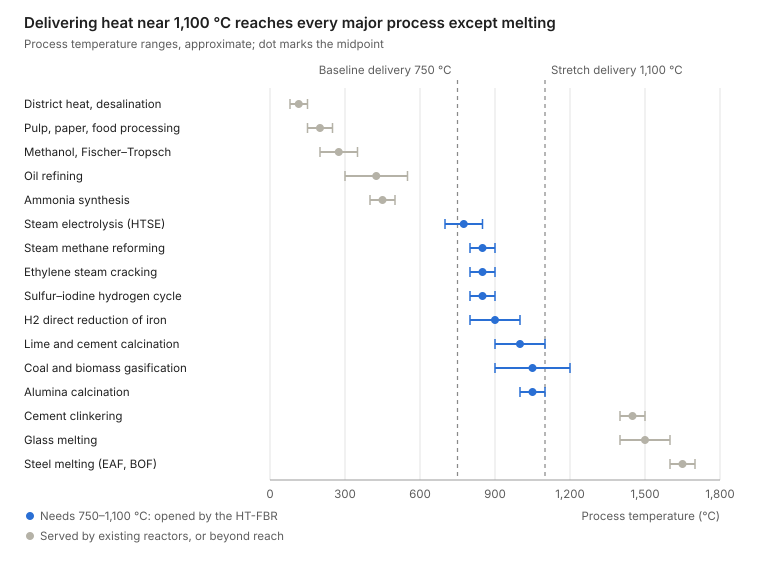

# Study: direct industrial heat

Heat delivered straight to a process avoids the Carnot loss: ~85–90% of core heat can reach the user, versus ~50% as electricity. Raising the delivery temperature from ~750 °C to ~1,100 °C opens hydrogen production, ethylene cracking, direct reduction of iron and calcination, all of which burn fossil fuel today.

Related: [brief](../project/brief.md) · [taxonomy axis 9 (PH-x codes)](../framework/taxonomy.md) · [liquid fuel at ~2,000 °C](liquid-fuel-2000c.md) (reaches melting processes) · [Q-001](../open-questions.md)

## Heat-mode figure of merit and targets

In heat mode the measure is delivered exergy: Ex = Q_user (1 − T0/T_user). With a 30 °C ambient the exergy fraction is ~63% at 550 °C and ~74% at 900 °C.

| Parameter | Baseline target | Stretch target |
| --- | --- | --- |
| Heat delivery temperature at the user | ≥ 750 °C | ≥ 1,000–1,100 °C |
| Share of core heat delivered to the user | ≥ 85% | ≥ 90% |
| Temperature drop, core outlet to user | ≤ 100 K | ≤ 60 K |
| Reactor-to-plant separation at < 2% heat loss | ≥ 0.5 km | ≥ 2 km |
| Heat / electricity split | Fixed at design | Adjustable in operation (cogeneration) |
| Response to total loss of industrial load | Passive, self-limiting core response | Same, with no reactor trip needed |

Process temperature bands *(approx.)*: below ~550 °C (district heat, pulp, methanol, refining, ammonia) existing reactors suffice; 700–1,200 °C (steam electrolysis, methane reforming, ethylene cracking, sulfur–iodine hydrogen, H2 direct reduction of iron, calcination, gasification) is the HT-FBR niche; 1,400–1,700 °C (cement clinkering, glass, steel melting) needs another source or [~2,000 °C fuel](liquid-fuel-2000c.md).

## Candidate use cases

| Use case | Code | Heat need (approx.) | Fit | Key physics issues |
| --- | --- | --- | --- | --- |
| Sulfur–iodine or hybrid-sulfur thermochemical hydrogen | PH-SI | ~1,000 MWth per 100 kt H2/year at ~45% (HHV) | Strong at T3–T4; heat only | H2SO4 decomposition at ~850 °C; acid corrosion of heat exchangers |
| High-temperature steam electrolysis | PH-HTSE | ~450 MW per 100 kt H2/year, mostly electric | Good with cogeneration | Mostly electricity |
| Hydrogen direct reduction of iron | PH-DRI | ~50–60 kg H2 per t iron, plus gas preheat to ~900 °C | Strong: H2 and heat | Melting (EAF) still electric |
| Ethylene steam cracking | PH-CRK | Several hundred MWth per Mt ethylene/year | Needs T4 (fired side 1,000–1,100 °C) | Heat flux to coils; radiant → convective redesign |
| Steam methane reforming | PH-SMR | Process-dependent | Good at T3 | Process CO2 unless captured |
| Lime and cement calcination | PH-CAL | ~100 MWth per Mt clinker/year for the calciner (~60% of kiln heat) | Good at T4; indirect calciner gives pure CO2 | Clinkering at ~1,450 °C needs another source |
| Alumina calcination | PH-ALU | Process-dependent | Good at T4 | Solid–gas heat transfer |
| Coal or biomass gasification | PH-GAS | Process-dependent | Partial | Tar, ash, slag |
| Low-temperature cascade | PH-LT | Uses reject heat | Bottoming | Total heat use > 90% |

## Coupling architecture

- **An intermediate loop, always**: keeps activated coolant, tritium and Po-210 out of products; each heat exchanger costs ~30–60 K.
- **Heat carrier**: helium (any T, ~5–7 MPa, large pipes); chloride or fluoride salts (> 1,000 °C, low pressure, freeze at ~400–500 °C); lead or tin; steam < ~600 °C.
- **Thermal storage buffer** separates the reactor from plant trips and batch processes.
- **Tritium permeation** into hydrogen products, worst for Li-7 branches (B1, B6); barriers or a second loop may be needed.
- **Heat exchanger materials**: Alloy 617/230 stop at ~950 °C; above that, ceramic (SiC) exchangers.

## Co-location hazards to model

| Hazard | Direction | What to model |
| --- | --- | --- |
| Explosion overpressure (H2, hydrocarbons, dust) | Plant → reactor | Blast load vs separation distance |
| Toxic or corrosive release (SO2/SO3, HI, H2S, Cl2, NH3) | Plant → reactor | Ingress into passive air-cooled decay-heat paths |
| Sudden loss of heat sink (plant trip) | Plant → reactor | Unprotected loss-of-heat-sink transient |
| Overcooling (demand spike, cold return) | Plant → reactor | Reactivity from negative temperature feedback; salt freezing |
| Tritium and activation products in products | Reactor → plant | Permeation chain |
| Reactive coolant fire (Li, Al with water) | Reactor → plant | Reaction energy; Pb, He, salts milder |
| Leak across the intermediate loop | Both | Pressure ordering |

## Consequences for screening

- The 1,100 °C stretch target favours T4 designs (B1, B3, B5, B6); B4 suits cogeneration and HTSE.
- Screening criteria to add: tritium production per MWth; chemical reactivity of the coolant with process media.
