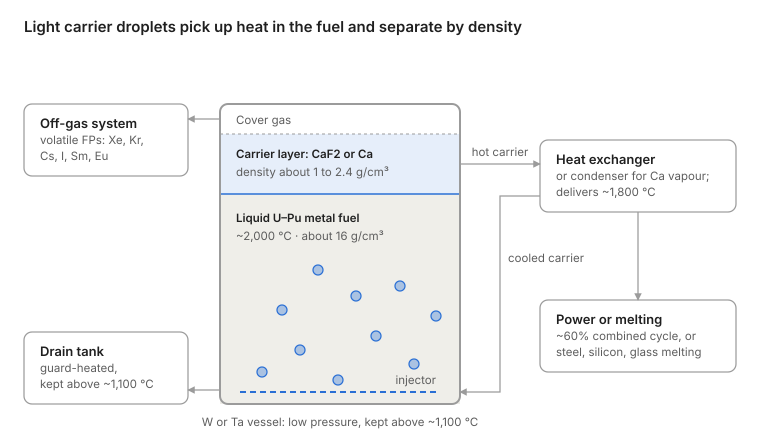

# Study: liquid fuel at ~2,000 °C

Possible in principle, but only with liquid uranium–plutonium metal as the fuel. The heat-carrying medium cannot simply touch it: no metal is at once immiscible with liquid uranium, liquid at 2,000 °C at modest pressure, and free of significant activation. The best options are lead behind a tungsten wall ([X1](../designs/X1.md)), or direct contact with a light immiscible carrier: molten CaF2 ([X2](../designs/X2.md)) or boiling calcium ([X3](../designs/X3.md)). An aluminium-cooled variant is [A2](../designs/A2.md).

Values tagged *(db)* are from the [property database](../data/database.md) (NIST-JANAF; above an element's boiling point, Clausius–Clapeyron extrapolation). Others are *(approx.)*.

## Which fuels are liquid at 2,000 °C

| Fuel family | Liquid range | Pressure at 2,000 °C | Spectrum | Verdict |
| --- | --- | --- | --- | --- |
| [U–Pu metal](../materials/uranium-plutonium-metal.md) | Melts ~1,130 °C (pure U); boils ~4,100 °C | U ~10⁻⁵ bar; Pu ~1 mbar *(approx.)* | Very hard | **Best fit** |
| Fluoride salt (LiF/NaF–UF4–PuF3) | Melts 500–700 °C; LiF boils ~1,700 °C *(db: 1,717 °C, incl. dimers)* | ~5–10 bar plus volatile UF4 | Intermediate to fast | Pressurised only; fuel evaporates |
| Chloride salt (NaCl–UCl3–PuCl3) | NaCl boils ~1,490 °C *(db: 1,487 °C)*; UCl4 ~790 °C | Tens of bar | Fast | Poor: fuel too volatile |
| Oxide, carbide, nitride | Melt 2,500–2,865 °C | — | — | Still solid |

Precedents: LAMPRE (Los Alamos, 1961–63) ran molten Pu–Fe fuel in tantalum capsules; the Dual Fluid concept proposes U–Cr metal fuel with lead coolant at ~1,000 °C. Cr or Fe additions are not needed at 2,000 °C ([D-0003](../decisions/D-0003-no-cr-fe-in-liquid-fuel.md)).

## What 2,000 °C buys

- **Efficiency**: Carnot 87%, Curzon–Ahlborn 64% (30 °C sink); a combined cycle could plausibly reach ~60%.
- **Heat uses**: delivered at ~1,800 °C, covers steel, silicon and glass melting and cement clinkering ([industrial heat](industrial-heat.md)).
- **Self-cleaning fuel**: Xe, Kr, Cs, I, Te and much of the Sm and Eu evaporate, removing poisons online but moving a hot, decay-heating inventory into the off-gas system.
- **No fuel damage limit**: fission gas escapes freely; burnup is set by chemistry and processing.
- **Kinetics**: with a stationary pool, delayed-neutron precursors stay in the core (Pu-239 β ≈ 0.0021); liquid expansion gives strong negative feedback.

## Candidate heat carriers

Criteria: (1) little mutual solubility with liquid U–Pu if in direct contact, (2) much lower density than the fuel (~16 g/cm³), (3) liquid at 2,000 °C at a few bar at most, (4) low fast-neutron absorption, (5) stable or short-lived capture products, (6) compatible with the boundary.

| Carrier | Melt / boil (°C) | Vapour pressure at 2,000 °C | Density at 2,000 °C (approx., g/cm³) | Activation | Contact with liquid U | Contact with W | Verdict |
| --- | --- | --- | --- | --- | --- | --- | --- |
| [Pb](../materials/lead.md) | 327 / ~1,750 | ~3.3 bar *(db, extrapolated)* | ~8.7 | Clean | UPb, UPb3: likely dissolves U | Excellent | Best behind a W wall |
| [Ca](../materials/calcium.md) | 842 / ~1,500 *(db: 1,501)* | ~9 bar *(db, extrapolated)* | ~1.2 | Near-clean | Immiscible | Good | Boiling direct-contact candidate |
| [CaF2](../materials/calcium-fluoride.md) | ~1,420 / ~2,530 | ~0.04 bar *(db)* | ~2.4 | Clean | Immiscible (slag separation) | Good | **Strongest direct-contact candidate** |
| Sn | 232 / 2,602 | ~0.04 bar *(approx.; Sn not in JANAF)* | ~6.0 | Moderate | USn3 | Fair | Behind a wall only |
| Cu | 1,085 / ~2,560 | low | ~7.0 | Short-lived | UCu5 | Good | Behind a wall only |
| [Al](../materials/aluminium.md) | 660 / ~2,500 *(db: 2,518; handbooks 2,470)* | ~0.05 bar *(db)* | ~2.1 | Clean | UAl2–UAl4 | Attacks W | Needs a non-metal wall ([aluminium coolant](aluminium-coolant.md)) |
| Si | 1,414 / ~3,230 *(db)* | very low | ~2.5 | Clean | Silicides | WSi2 | Out of core only |

Melting a product metal (steel, Al, Si) inside the core is ruled out: iron activates (Fe-59, Mn-54, Co-60) and the activation-clean metals react with uranium and tungsten. Products are melted outside, through the carrier loop.

## Coupling options

| Architecture | Boundary in the core | Main advantage | Main physics risk |
| --- | --- | --- | --- |
| [X1](../designs/X1.md) Pb behind W tubes | W or W–Re tube wall | Pb–W compatibility; small pressure difference | W creep and embrittlement; U–W mass transfer |
| [X2](../designs/X2.md) CaF2 direct contact | None: salt droplets rise through fuel | No hot heat-transfer wall | Fuel carry-over; fission-product exchange; F moderation |
| [X3](../designs/X3.md) Boiling Ca direct contact | None: Ca boils in the fuel | Large latent heat, isothermal delivery | ~9 bar; void reactivity; U/Pu solubility in Ca |

## The tungsten boundary

See [tungsten](../materials/tungsten.md): melts ~3,400 °C, barely attacked by Pb, Ca or CaF2, no compounds with uranium. Weak points: creep (a few MPa at 2,000 °C), irradiation embrittlement (kept ductile because the plant must stay above the ~1,100 °C fuel freezing point), recrystallisation above ~1,200–1,400 °C, transmutation to Re and Os, and fuel-side mass transfer. Fallbacks: tantalum (LAMPRE), Y2O3 or ThO2 ceramics.

## Unknowns

[Q-020](../open-questions.md) to [Q-025](../open-questions.md): mutual solubilities, fuel carry-over in direct-contact columns, fission-product partitioning, reactivity of carrier fraction and voids, Pu vapour transport, freeze and drain behaviour.
