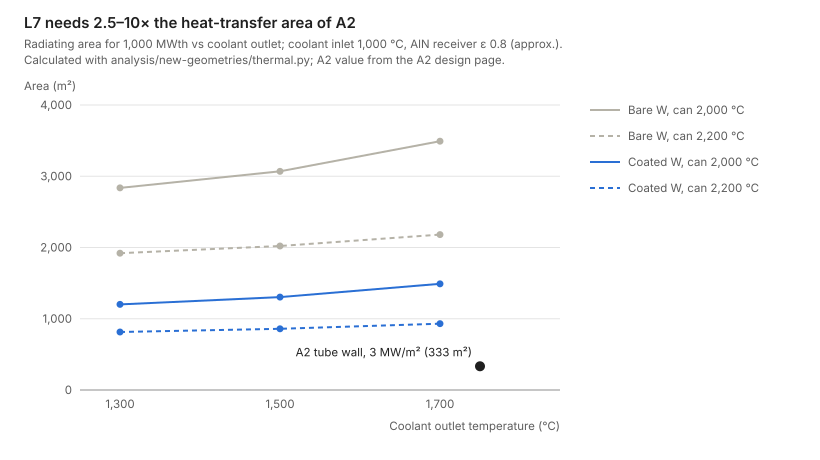

# Study: new core geometries, Phase 1 scoping

**Main result.** Of the seven candidate geometries, only the radiatively coupled pool (L7) changes the wall problem fundamentally, and it survives a first quantitative check. With coated tungsten fuel tubes at 2,000 °C radiating to aluminium-cooled AlN panels, a 1,000 MWth core needs ~1,400 m² of tube surface, ~15 m³ of core and ~100 t of liquid U–Pu, about 4× A2's volume and 3× its fuel. It still breeds: clean-critical Pu fraction 8.9% and breeding ratio ~1.7 with a blanket (A2 at its own size: 8.1% and ~1.9), with aluminium leaving at 1,500 °C. It becomes the R design family ([R1](../designs/R1.md), with [R2](../designs/R2.md) and [R3](../designs/R3.md) as cooled-wall variants). L3 liquid-fuel pins are a sound geometry option for [A2](../designs/A2.md) and [X1](../designs/X1.md) rather than a new family. S6 printed lattice deserves a seed page. S9 belongs with the R family, while S5, S8 and L5 should be parked.

**Status:** Phase 1 scoping (2026-11-20). Input: [geometry by phase](geometry-by-phase.md), [Q-006](../open-questions.md). Methods: [materials selection](../framework/materials-selection.md) rules R1–R10 and evidence levels E1–E5, the infinite-medium screen in `analysis/common/infinite.py`, and the scripts in [analysis/new-geometries/](../../analysis/new-geometries/README.md). Numbers are tagged *(calc)* (script output), *(db)* (property database) or *(approx.)*.

## Comparison

All at 1,000 MWth. Neutronics: infinite homogenised medium, reactor-grade Pu (approx. vector: Pu-238 2, Pu-239 60, Pu-240 24, Pu-241 9, Pu-242 5 at%), depleted U (0.25% U-235), N-15 99.9% *(calc, neutronics.py)*. Thermal: governing limit and the core size it implies *(calc, thermal.py; properties approx.)*.

| Candidate | Configuration (volume fractions) | Governing heat-transfer limit | Core (m³) | Fuel (t) | Pu for k∞ 1.15 | CR | Median E (keV) | Coolant void (pcm) | Pu in core (t) | Outlet (°C) |
| --- | --- | --- | --- | --- | --- | --- | --- | --- | --- | --- |
| A2 reference | Liquid U–Pu 67%, W 10.6%, AlN 3%, Al 19.6% | Tube wall ~3 MW/m² | 3.3 | 35 | 9.1% | 1.45 | 196 | +3,670 ± 60 | 3.2 | 1,750–1,880 |
| **L7 / R1** tubes, Al/AlN | Fuel 43%, W 9%, AlN 6%, Al 12.5%, N2 gap 30% | Radiation 0.77 MW/m² (coated W, 2,000 °C) | 15.1 | 103 | 10.2% | 1.32 | 196 | +3,010 ± 80 | 10.5 | 1,500 |
| L7 / R2 tubes, Pb/Mo | As R1, Mo walls and Pb | Radiation 0.76 MW/m² (coated receiver) | 15.1 | 103 | 10.0% | 1.24 | 215 | +1,310 ± 70 | 10.3 | 1,400–1,500 |
| L7 / R3 tubes, He/Mo | As R1, Mo tubes and He | Radiation 0.67 MW/m² | 17.1 | 117 | 9.8% | 1.26 | 215 | gas | 11.4 | 1,300–1,500 |
| L7 plates, 20 mm | Fuel 62.5%, W 6%, AlN 6%, Al 12.5%, gap 12.5% | Radiation 0.77 MW/m² | 20.9 | 209 | 8.5% | 1.55 | 196 | +2,530 ± 60 | 17.7 | 1,500 |
| L7 plates, 40 mm | Fuel 77% | Radiation 0.77 MW/m² | 33.9 | 417 | 7.4% | 1.71 | 215 | — | 31 | 1,500 |
| S9 radiating UN plates | (U,Pu)N 56%, W 4%, AlN 8%, Al 16%, gap 16% | Radiation 0.77 MW/m² (power zoned) | 16.3 | 124 | 11.3% | 1.37 | 148 | +2,840 ± 70 | 13.2 | 1,500 |
| S5 fluidised bed, He | (U,Pu)N 43%, ZrN 7%, He 45%, Mo 5% | Fluidisation window: 16–32 MW per m² of bed | ~31 (1 m bed) | ~180 | 10.7% | 1.38 | 162 | gas | ~18 | ~1,200 |
| S6 printed lattice, He | (U,Pu)N 42%, Mo 18%, He 40% | He pumping ~26 MW at 100 MW/m³ | 10 | 57 | 12.8% | 1.11 | 178 | gas | 6.9 | 1,100–1,300 |
| S8 particle-cooled pins | (U,Pu)N 30%, Mo 8%, Al2O3 36%, gas 26% | Granular flow h ~600 W/m²K: 0.18 MW/m² | 33 | 134 | 17.6% | 0.94 | 101 | +18,760 ± 70 | 22 | ~1,200 |
| L3 pins, Al | Fuel 47%, W 18%, AlN 7.5%, Al 28% | Wall 3 MW/m² (as A2) | 1.3* | 10* | 12.9% | 1.07 | 178 | +4,750 ± 60 | 1.2* | 1,750–1,900 |
| L3 pins, Pb | Fuel 52%, W 20%, Pb 28% | Wall 3 MW/m²; Pb 3.3 bar for 1,700 °C | 1.3* | 11* | 11.2% | 1.11 | 215 | +2,110 ± 90 | 1.2* | 1,450–1,700 |
| L5 falling film, Al | Fuel 29%, W 17%, AlN 4%, Al 29%, gas 21% | Wall 3 MW/m² (as A2) | 2.3* | 11* | 16.0% | 0.87 | 178 | +6,360 ± 60 | 1.7* | 1,750–1,900 |

\* Heat-transfer size only; a real core is larger, set by criticality and blankets. Pu in core is fuel mass × heavy-metal fraction × Pu fraction at k∞ 1.15, with no blanket or out-of-core inventory. Source: `results/summary.csv` *(calc)*.

How to read it:

- **Pu fraction and conversion ratio track the fuel volume fraction and the wall material.** Dense liquid U–Pu at high fraction (A2, L7 plates) needs 7.4–9.1% Pu and converts at 1.45–1.71. Thin-walled pins (L3) and films (L5) carry 17–20% tungsten. They need 11–16% Pu and convert at only 0.87–1.11. The particle-cooled core (S8) is the only candidate with a softened spectrum (median ~100 keV, from Al2O3); it needs 17.6% Pu and does not breed in the core.
- **Coolant-void worths are positive in every liquid-cooled case** (infinite medium, no leakage): removing Al or Pb hardens the spectrum. They are an upper bound; leakage in a finite core reduces them.
- **Core size is set by heat transfer only for the radiative, granular and fluidised cases.** For L3 and L5 the heat-transfer size (1–2 m³) is below any critical size, so criticality and blankets set the core, as for A2.

## L7 radiatively coupled pool

Given the most depth because it is the only mode in which no material touches both fuel and coolant. Design pages: [R1](../designs/R1.md) (reference, Al in AlN panels), [R2](../designs/R2.md) (Pb in Mo panels), [R3](../designs/R3.md) (He in Mo panels, direct Brayton).

### Reference configuration

Rows of vertical tungsten tubes (20 mm bore, 1 mm wall, 23 mm pitch) hold the liquid U–Pu. A 2 mm gap on each side of a row separates the tubes from cooled panels (1 mm AlN walls, 4 mm aluminium channel); one panel serves two rows. The cell pitch is 32 mm. Volume fractions are fuel 42.7%, W 9.0%, AlN 6.3%, Al 12.5% and gap 29.6% *(calc)*. The tube surface runs at 2,000 °C, the same peak-wall class as A2. Aluminium enters at 1,000 °C at the top and leaves at 1,500 °C.

Why tubes and not plates: plates pack more fuel (a 20 mm slab gives 62.5%), but the hydrostatic head of liquid U–Pu bends them. A 0.5 m column gives 16 MPa in a 1 mm plate on a 20 mm span. A tube of radius 10 mm sees only 0.8 MPa hoop stress at 0.5 m and 1.6 MPa at 1 m *(calc)*. The core is therefore built in tiers ≤ ~1 m tall.

### Surface area: is it affordable?



Net flux between grey surfaces is σ(T_h⁴ − T_c⁴)/(1/ε₁ + 1/ε₂ − 1). The calculation reproduces the table in [geometry by phase](geometry-by-phase.md#second-dimension-phase-of-the-coolant): 0.78 MW/m² at 2,000/1,300 °C with ε 0.8/0.8. Two refinements matter:

1. **The coolant heats up along the panel**, so the average flux is a harmonic mean over coolant temperature.
2. **The hot surface stays nearly isothermal** if the coolant enters at the top. Liquid fuel cooled at the top of a tube sinks and stirs it. Solid fuel (S9) cannot do this. Its bounding case, uniform power with the hottest point at the coolant outlet, gives 20% less flux at a 1,500 °C outlet.

| Container surface, emissivity | Al outlet | Panel flux (MW/m²) | Area for 1 GW (m²) | Core (m³) | Fuel (t) | Fuel peak (°C) |
| --- | --- | --- | --- | --- | --- | --- |
| 2,000 °C, coated 0.8 | 1,300 °C | 0.83 | 1,202 | ~14 | ~95 | ~2,120 |
| **2,000 °C, coated 0.8 (R1)** | **1,500 °C** | **0.77** | **1,304** | **15.1** | **103** | **2,122** |
| 2,000 °C, coated 0.8 | 1,700 °C | 0.67 | 1,490 | ~17 | ~118 | ~2,120 |
| 2,000 °C, bare W 0.3 | 1,500 °C | 0.33 | 3,069 | 33.8 | 231 | 2,054 |
| 2,200 °C, coated 0.8 | 1,500 °C | 1.16 | 859 | 9.9 | 68 | 2,376 |
| A2 (conducting wall) | 1,750 °C | ~3 | 333 | 3.3 | 35 | 2,100 |

*(calc, thermal.py; AlN receiver ε 0.8, panel thermal resistance 4.4 × 10⁻⁵ m²K/W; core and fuel from the tube-row cell; A2 from its design page.)* Area is panel-equivalent; the tube surface is ~8% larger (1,413 m² for R1).

What this says:

- **It fits.** 15 m³ is a cylinder ~2.7 m across and tall: larger than A2 but in the range of a sodium fast reactor core.
- **Emissivity is the lever that decides it.** Bare tungsten (~0.3) more than doubles area, volume and inventory. A receiver as poor as bare molybdenum (~0.25) would cut the flux to 0.27 MW/m² even with a coated tube *(calc)*. Both surfaces must be good radiators.
- **Outlet temperature is nearly free.** Going from 1,300 °C to 1,700 °C aluminium outlet costs 24% more area. In A2 the outlet is limited by conduction drops through fuel and wall. In L7 it is limited by receiver chemistry (below).
- **Inventory is the real cost.** Specific power is ~10 MW per tonne of fuel, against ~29 in A2. Smaller tubes help: at r = 7.5 mm the core is 12.8 m³ and holds 75 t, at the price of a lower fuel fraction (36%).

### Does the larger core still breed?

| Case | Pu for k∞ 1.15 | CR at k∞ 1.15 | Al-void worth (pcm) | Finite core + 40 cm blanket: critical Pu, BR |
| --- | --- | --- | --- | --- |
| A2 reference (67% fuel) | 9.1% | 1.45 | +3,700 ± 60 | 8.1%, 1.90 (3.3 m³) |
| L7 tubes, Al/AlN (R1) | 10.2% | 1.32 | +3,000 ± 80 | 8.9%, 1.71 (15.1 m³) |
| L7 tubes, Pb/Mo (R2) | 10.0% | 1.24 | +1,300 ± 70 (Pb) | — |
| L7 tubes, He/Mo (R3) | 9.8% | 1.26 | none (gas) | — |
| L7 plates, 20 mm (62.5% fuel) | 8.5% | 1.55 | +2,500 ± 60 | — |

*(calc: neutronics.py, finite.py. Finite model: homogenised cylinder H = D at the thermal size, 40 cm blanket of the same cell with depleted U, vacuum outside, clean fuel; the breeding ratio is fertile captures over fissile absorptions in core and blanket, an upper-bound proxy.)*

**Statistics and worths of the reference** (50,000 × 100 batches; *calc, l7_detail.py*): k∞ = 1.1493 ± 0.0003 at 10.18% Pu, CR 1.326. Evacuating the N2 gap: −27 ± 37 pcm. Voiding the aluminium: +3,010 ± 35 pcm. Flooding the gap with aluminium (panel breach): −6,260 ± 36 pcm. Flooding with lead: −2,950 ± 33 pcm. Gap gas is neutronically irrelevant, and a breach that floods the gap is a negative-reactivity event.

Yes. The radiative core breeds about as well as A2 per unit of fuel fraction. Its lower fuel fraction costs ~1 point of Pu and ~0.1–0.2 of breeding ratio, and the larger size recovers part of that through lower leakage. The cost shows up in doubling time instead. The Pu inventory is ~9–10 t against ~3 t for A2, so at equal breeding gain the doubling time is ~4× longer. Proxy (fissile 69% of Pu, +20% out of core, 1.25 kg/day per GWth consumption): ~23 years for R1 against ~6 for A2 at the breeding ratios above. The A2 page's 20–35 years assumes BR 1.3–1.5 and 12% Pu, which brackets the realistic case.

### Container options

| Container | Melting point *(db)* | Fast absorption *(db)* | k∞ change in R1 at fixed Pu *(calc)* | Fuel-side verdict |
| --- | --- | --- | --- | --- |
| W (reference) | 3,422 °C | 54.9 mb | — | No U–W compounds known; solubility at 2,000 °C unknown (E5) |
| Ta | 3,017 °C | 111.5 mb | −6,600 pcm; +1.2 points of Pu to recover k∞ 1.15 | LAMPRE analogue (molten Pu alloy in Ta, far below 2,000 °C, E2); unknown at temperature (E5) |
| Re | 3,185 °C | 138.8 mb | −15,200 pcm; +2.5 points of Pu | U–Re intermetallics likely (E5) |
| Mo | 2,623 °C | 33.2 mb | +4,200 pcm; −0.9 points of Pu | Unknown (E5); at 2,000 °C only ~600 K below melting, so creep |

*(calc, neutronics.py `--swaps`: 1 mm can of each metal at the W-case Pu fraction of 10.2%, 20,000 × 60. Conversion ratio at fixed Pu: W 1.32, Ta 1.25, Re 1.18, Mo 1.32.)*

Tungsten stays the reference. Tantalum is the fallback. LAMPRE kept molten plutonium alloy in tantalum, but far below 2,000 °C, so it is only an analogue. Rhenium belongs only in W–Re alloys for ductility, never on the wetted face. The emissivity coating faces only gap gas, so its chemistry is decoupled from both fluids. The candidates are textured or dendritic tungsten (no new material) and ZrC (low absorption, but carbon diffuses into W; conditional, E5).

### Gap: vacuum or gas

| Option | Extra coupling at 2,000/1,400 °C *(calc)* | For | Against |
| --- | --- | --- | --- |
| Vacuum | 0 | Cleanest radiation; any gas appearing signals a leak | AlN evaporates: at 1,300–1,500 °C, p(Al) 10⁻⁶–4 × 10⁻⁵ bar *(db)*, an upper bound of 0.8–29 m/year recession at unit evaporation coefficient *(calc)* |
| **N2, ~1 bar (R1)** | +0.035 MW/m² | Suppresses AlN evaporation 230–4,300×. p(Al) stays under 10⁻⁶ bar up to ~1,550 °C *(db)*. A fuel leak forms nitride at the breach | N-14 in the gas (negligible at gas density); slight conduction |
| He, ~1 bar | +0.18 MW/m² | +25% coupling with coated tubes, +60% with bare | No help for AlN; transports vapours |
| Ar, ~1 bar | +0.02 MW/m² | Inert, heavy | Ar-41 activation |

Radiation at the same temperatures is 0.71 MW/m² (coated) or 0.30 MW/m² (bare); convection is negligible (Ra ~0.002). Swapping gap gas is a slow coupling trim that no wall has to survive. It can hold the fuel molten at low power (freeze margin) or add ~25% capacity.

### Cooled-wall side

| Coolant in panels | Panel | Flux (coated, 2,000 °C, outlet 1,500 °C) *(calc)* | Outlet limit | Chemistry | Neutronics *(calc)* |
| --- | --- | --- | --- | --- | --- |
| **Al (R1)** | AlN, N-15 | 0.77 MW/m² | Receiver surface ≤ ~1,550 °C under 1 bar N2 (R4) | AlN/Al compatible (own nitride, E3) | Pu 10.2%, CR 1.32 |
| Pb (R2) | Mo, coated on the gap side | 0.76 MW/m² (if the coating gives ε ~0.8) | 1,400 °C at 0.8 bar, 1,500 °C at 1.3 bar, 1,700 °C at 3.3 bar for a 300 K boiling margin *(db)* | Mo/Pb: low solubility (E5 at this temperature); no ceramics | Pu 10.0%, CR 1.24 |
| He, 7 MPa (R3) | Mo tubes | 0.67 MW/m² (He film) | Mo creep: 14 MPa hoop in a 4 mm bore, 1 mm wall | Inert; impurity control (R5) | Pu 9.8%, CR 1.26 |

Aluminium carries the most heat per kilogram (~1,700 kg/s against ~14,300 for Pb and ~385 for He) and gives the best conversion ratio. AlN is also a naturally good absorber, so R1 is the reference. R2 avoids ceramics altogether and runs below Pb's boiling margin. R3 goes straight to a Brayton cycle with no liquid coolant.

### Chemistry: what the geometry changes

Pair verdicts are detailed on [R1](../designs/R1.md#chemistry-who-touches-whom). In summary:

- **Fuel / W tube, ~2,120 °C:** conditional, E5. It is the same pair as A2's fuel side. It is now the only pair at peak temperature, and it involves a single liquid.
- **W / gap gas:** compatible.
- **Gap / receiver:** a new R4 volatility issue. AlN facing vacuum fails (E3, JANAF). Under 1 bar N2 it passes up to ~1,550 °C.
- **Receiver / coolant:** compatible (AlN/Al at 1,500 °C, ~300 K cooler than in A2).
- **Fuel meeting coolant now needs two independent breaches**, and the gap gas reveals which side failed.

## S9 radiating solid fuel elements

(U,Pu)N plates, 14 mm thick in 0.5 mm W cans, radiating across 2 mm gaps to AlN/Al panels: fuel 56%, W 4%, AlN 8%, Al 16%, gap 16% *(calc)*.

- **Thermal.** The same radiation limit as L7, but solid fuel cannot even out its own surface temperature. With unzoned power the flux is 0.61 MW/m² and the core 20.4 m³; with power zoned to match, 0.77 MW/m² and 16.3 m³. Plate centre-to-surface rise is ~110–135 K at k ~20 W/m·K (approx.).
- **Neutronics.** Pu 11.3%, CR 1.37, median energy 148 keV (nitrogen softens it), Al-void worth +2,840 ± 70 pcm *(calc)*. Close to R1, with more Pu because UN carries less heavy metal per volume than liquid U–Pu.
- **Chemistry.** The UN surface at ~2,000 °C+ is above where nitride holds its nitrogen without overpressure. UN data are missing from JANAF ([Q-012](../open-questions.md)), so the evidence is E5. Fission gas must be vented through the can, and swelling limits burnup. In exchange there is no liquid containment.
- **Verdict.** Same surface physics as L7, worse fuel behaviour at 2,000 °C, no online processing. Treat it as a solid-fuel variant inside the R family, not a family of its own.

## L3 liquid-fuel pins

Liquid U–Pu in sealed, vented W pins (9 mm bore, 0.8 mm wall), triangular p/d 1.12. Two coolants:

- **Al:** 0.3 mm AlN outer layer; fuel 46.7%, W 18.1%, AlN 7.5%, Al 27.7%.
- **Pb:** no outer layer; fuel 52.1%, W 20.2%, Pb 27.7%.

| | L3 / Al | L3 / Pb |
| --- | --- | --- |
| Pu for k∞ 1.15, CR *(calc)* | 12.9%, 1.07 | 11.2%, 1.11 |
| Coolant-void worth *(calc)* | +4,750 ± 60 pcm | +2,100 ± 90 pcm |
| Fuel conduction drop at 3 MW/m² *(calc)* | 169 K (A2: ~205 K) | 169 K |
| Outlet | 1,750–1,900 °C (as A2, slightly better) | Pb needs 3.3 bar for 1,700 °C with a 300 K boiling margin *(db)* |

- **The geometry localises breaches and halves the fuel conduction path.** But it multiplies tungsten: 18–20% of the volume, twice A2's. That costs ~4 points of Pu and ~0.35 of conversion ratio compared with A2.
- **The wall still faces two fluids.** With Al it is A2's W/AlN duplex (critical risk unchanged). With Pb both pairs (W/U, W/Pb) are expected compatible (E5, E2 analogue), as in X1.
- **Verdict.** A geometry option of A2 (its G3) and of X1, not a new family. Thicker pins (≥ 12 mm bore) would recover fuel fraction.

## S6 printed lattice

A printed (U,Pu)N–Mo cermet (70/30 vol%) gyroid lattice, solid fraction 0.60, He at 7 MPa. Solid struts are 1 mm wide and coated with Mo or W on the coolant side.

- **Neutronics.** Pu 12.8%, CR 1.11, median energy 178 keV *(calc)*. Mo takes ~13% of absorptions; a W matrix would cost more.
- **Thermal.** Neither the fuel nor the wall limits: the strut rise is ~1 K, and the film rise is 24 K at a surface flux of 0.1 MW/m² (h ~4 kW/m²K). Helium pumping limits instead. At 100 MW/m³ (10 m³ core) the pressure drop is ~230 kPa and pumping takes ~26 MW, ~2.5% of thermal power *(calc)*.
- **Chemistry.** Fuel and He meet only through a thin printed coating. He is inert, so no liquid–solid pair exists. R5 impurity control applies to Mo (MoO3 is volatile). Outlet is T4, with T5 possible if the coating holds.
- **Risks.** Printing dense nitride–metal cermets, inspection, and irradiation of 1 mm struts (swelling, fission-gas release into the coolant).
- **Verdict.** A credible He-cooled T4–T5 solid-fuel route with a manufacturing bet, sibling to [B3](../designs/B3.md). Worth a seed page.

## S5 fluidised bed

(U,Pu)N kernels (1 mm, 25 µm ZrN coat), bed solids 0.50, He at 7 MPa, Mo walls 5%.

- **Neutronics** are fine: Pu 10.7%, CR 1.38, median energy 162 keV *(calc)*. The He worth is negligible. Expansion feedback is a leakage effect that the infinite medium cannot show.
- **Heat removal is the problem.** Gas velocity is pinned between minimum fluidisation (0.9 m/s for 1 mm UN particles in 7 MPa He, Wen–Yu) and entrainment. At 2–4 × u_mf the bed carries only 16–32 MW per m² of cross-section with a 600 K helium rise. A 1 GWth bed would be 6–9 m wide. 3 mm particles raise this to 39–78 MW/m². A lead-fluidised bed is no better (11–31 MW/m², terminal velocity 0.1–0.2 m/s). Every case means a wide, flat, leaky core unless the bed rotates (10× at 100 g, approx.).
- **Chemistry.** The particle coating is the only fission-product barrier and is abraded continuously.
- **Verdict.** Park.

## S8 particle-cooled core

(U,Pu)N pins (8 mm, 0.5 mm Mo clad, 13 mm square pitch) with Al2O3 particles falling through the channels at packing 0.58: fuel 29.7%, Mo 7.9%, Al2O3 36.2% *(calc)*.

- **Neutronics.** Pu 17.6%, CR 0.93, median energy ~100 keV *(calc)*. Al2O3 softens the spectrum, and no breeding in the core is possible at this fuel fraction. Draining the particles (flow stops, channels empty) is worth **+18,800 ± 70 pcm** in the infinite medium, because removing a moderating carrier hardens the spectrum sharply. Even after leakage, that is disqualifying without a large shutdown margin.
- **Thermal.** Wall-to-dense-granular-flow coefficients of ~300–1,000 W/m²K (approx., falling-particle receiver literature, to be sourced) give 0.09–0.3 MW/m² at a 300 K film drop, hence a 20–66 m³ core. Particle flow is ~1,600 kg/s at 500 K rise (JANAF Cp) and ~0.08 m/s in the channels: slow, so abrasion is mild.
- **Chemistry.** Mo/Al2O3 is compatible (Al2O3 far more stable than Mo oxides; E5 here, Mo oxides are not in the database). Particles leave the core with Na-24 activation from Al(n,α) (15 h, db).
- **Verdict.** Park. It breeds poorly and is large. Its niche (no pressure, ceramic heat carrier to ~1,000–1,200 °C) is better served outside the core, as heat storage.

## L5 falling film

2 mm films of liquid U–Pu on both faces of W/AlN/Al panels (A2's wall), with 3 mm of gas space: fuel 28.6%, W 17.1%, AlN 4.3%, Al 28.6%, gas 21.4% *(calc)*.

- **Neutronics.** Pu 16.0%, CR 0.87, Al-void worth +6,360 ± 60 pcm *(calc)*. Tungsten takes ~23% of absorptions. With 29% fuel and 17% W this core cannot breed internally.
- **Thermal.** The film is turbulent (Re ~44,000, Brauer correlation), moving at ~1 m/s, with ~2.4 s in a 2.5 m core. The conduction drop is 75 K at 3 MW/m² (A2 ~205 K). The core would be only ~2.3 m³ by heat transfer.
- **Chemistry and kinetics.** Each wall still faces fuel and coolant: A2's critical risk, unchanged. The fuel is outside the film for part of each circuit, so delayed-neutron precursors decay out of the core.
- **Verdict.** Park. It improves the least important part of A2 (the fuel-side drop) and worsens breeding and kinetics.

## Ranked recommendation

1. **L7 radiatively coupled pool: create the R family** (done as [R1](../designs/R1.md), [R2](../designs/R2.md), [R3](../designs/R3.md), status exploring). It is the only geometry that splits the chemistry, it breeds, and it keeps a T5 outlet. Its critical unknowns, emissivity and the W container at 2,000 °C, are testable in small capsules.
2. **S6 printed lattice: seed page** in a new family (proposed letter P), He-cooled, T4–T5.
3. **L3 liquid-fuel pins: no new family.** Record it as geometry option G3 of A2 and as a pin variant of X1, with thicker pins.
4. **S9: variant inside the R family**, written up only if a solid-fuel radiative core is needed (for example, if liquid-fuel containment fails).
5. **S5, S8, L5: park**, with the reasons above.

Draft front matter for the pages not yet created (R1–R3 exist as pages):

```yaml
---
id: P1
title: Printed (U,Pu)N-Mo lattice, helium-cooled
family: Printed lattice cores
designation: "S-K | UPu | A | F | He | T4 | H | Lp | B-He | Ba"
status: seed
outlet_C: "1100-1300"
fuel: (U,Pu)N-Mo cermet (70/30 vol%) printed as a gyroid lattice, N-15, coated with Mo or W
coolant: He, 7 MPa
boundary: Thin printed Mo or W coating on each strut
key_risk: Printing dense nitride cermet lattices; irradiation of 1 mm struts and fission-gas release into the coolant
materials: [uranium-nitride]
studies: [studies/new-geometries-scoping.md, studies/geometry-by-phase.md]
questions: [Q-006, Q-012]
updated: 2026-11-20
---
```

```yaml
---
id: R4
title: Radiating (U,Pu)N plates in W cans, aluminium-cooled AlN panels
family: Radiatively coupled liquid fuel
designation: "S-N | UPu | A | F | Al | T5 | L | In | CC | Ba"
status: seed
outlet_C: "1300-1500"
fuel: (U,Pu)N plates, N-15, 14 mm, in 0.5 mm W cans with vented plenum
coolant: Al in AlN panels
boundary: none shared; W can and AlN panel separated by a N2-filled radiation gap
key_risk: UN nitrogen loss and swelling at a 2,000 °C surface; no online processing
materials: [uranium-nitride, tungsten, aluminium-nitride, aluminium]
studies: [studies/new-geometries-scoping.md, studies/geometry-by-phase.md]
questions: [Q-006, Q-012]
updated: 2026-11-20
---
```

## Proposed open questions

- What total hemispherical emissivity do textured W and ZrC-coated W keep at 1,800–2,200 °C after ≥ 1,000 h in N2 and in vacuum, and under irradiation?
- What is the evaporation coefficient and recession rate of AlN at 1,300–1,600 °C in vacuum and under 1 bar N2? Is a W-jacketed AlN panel a better receiver?
- Does liquid U–Pu in a vertical tube cooled by radiation from the top stay isothermal (natural convection), as the L7 sizing assumes?
- What fuel column height can a W tube at 2,000 °C carry for 3–4 years (creep under hydrostatic head), and how is a tiered core fed and drained?
- What are the heterogeneous (tube row and panel) and 3D finite-core critical Pu fraction, breeding ratio, coolant-void and gap-flooding worths for R1–R3?
- How are freeze and restart controlled when the fuel is coupled only by radiation (panel temperature, gap gas)?
- Which high-emissivity coating survives on Mo receiver tubes facing vacuum at 1,400–1,500 °C (R2, R3)?
- Is the axis-4 spectrum class of liquid U–Pu cores H or F? The median flux energy is ~196 keV for A2 and R1.
- What is the S5 fluidisation window for dense UN particles, and does a rotating bed change the verdict?
- What wall-to-particle heat-transfer coefficient do dense ceramic particles give at 1,000–1,300 °C (S8)?
- Can (U,Pu)N–Mo cermet gyroid lattices be printed dense, and how do 1 mm struts behave under irradiation (S6)?

## Proposed decisions

- Adopt the radiatively coupled family R (geometry L7, heat-transport mode K-R), with R1 (Al/AlN panels, N2 gap) as reference and R2 (Pb/Mo) and R3 (He/Mo) as cooled-wall variants. This answers the geometry half of [Q-006](../open-questions.md) for L7.
- Add axes 11 (geometry) and 12 (heat-transport mode) to the [taxonomy](../framework/taxonomy.md): this study needed both to tell R1 from A2, which share all ten current axes except spectrum.
- Record L3 as an A2/X1 geometry option rather than a family; open S6 as a seed family; park S5, S8 and L5 with the reasons given here.
- Make emissivity at 2,000 °C and W-in-liquid-U capsules the first R-family tests, ahead of loop work.

## Limits of this scoping

- Infinite homogenised medium for every candidate. The finite check covers only R1 and A2, homogenised, clean and without control margin.
- Liquid-fuel cases run at 2,100 K, the library maximum. Liquid-fuel temperatures (2,270–2,400 K) are above it, so Doppler is slightly understated.
- B-10 is missing from the library but no composition here uses boron. O-17/18 and C-13 are dropped (< 1.1 at%).
- Emissivities, granular heat-transfer coefficients, the AlN evaporation coefficient and all liquid-metal transport properties are approximate.
- All chemistry verdicts on fuel/container pairs are E5. No actinide CALPHAD data are loaded ([coverage](../data/calphad-coverage.md), [Q-014](../open-questions.md)).

## Related pages

[Geometry by phase](geometry-by-phase.md) · [A2](../designs/A2.md) · [X1](../designs/X1.md) · [R1](../designs/R1.md) · [R2](../designs/R2.md) · [R3](../designs/R3.md) · [Aluminium coolant](aluminium-coolant.md) · [Liquid fuel at ~2,000 °C](liquid-fuel-2000c.md) · [Materials selection](../framework/materials-selection.md) · [Open questions](../open-questions.md)
